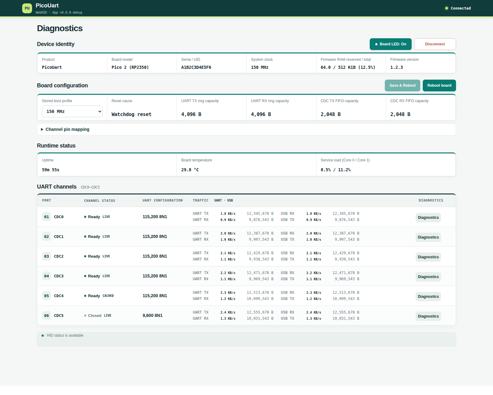

# PicoUart

[](https://github.com/djwinter29-oss/PicoUart/actions/workflows/pr-check.yml)
[](https://github.com/djwinter29-oss/PicoUart/actions/workflows/release.yml)
[](LICENSE)


A six-port USB-to-UART bridge for the Raspberry Pi Pico and Pico 2, with built-in health counters.

**Quick links:** [Releases](https://github.com/djwinter29-oss/PicoUart/releases) · [Hardware setup](docs/hardware-setup.md) · [Direct Dashboard](https://djwinter29-oss.github.io/PicoUart/) · [PyPI package](https://pypi.org/project/pico-uart/)

For bring-up benches and test racks, one board and USB cable replace a handful of single-port adapters. Existing
terminals and scripts keep working.

```text
Computer -- USB -- Pico / Pico 2 +- UART0 -- Device A
                                 |- UART1 -- Device B
                                 |- ...
                                 `- UART5 -- Device F
```

## Why PicoUart?

When a serial log goes quiet, PicoUart's per-channel counters help distinguish a silent device from bytes lost by the
bridge or an unread host buffer.

Each UART shows up as an ordinary USB CDC serial port, so your terminals and scripts need nothing extra. The counters,
dropped-byte counts, and buffer peaks come over a separate USB HID interface, which means checking health never
disturbs an open serial port. Read them in the browser dashboard, from Python or .NET, and save them with your test
results.



_The dashboard with simulated telemetry._

## Before You Connect

- Use **3.3 V UART logic** and a shared ground. Never connect 5 V or RS-232 signals directly.
- UART0-1 use the hardware UARTs. UART2-5 use PIO and support **8N1 only**.
- RTS/CTS flow control is off by default and has not been tested on hardware yet.

## Get Started

1. Follow [hardware setup](docs/hardware-setup.md) to install firmware and wire your device.
2. Open the matching serial port in your terminal or script, and set the baud rate and framing your device needs.

The host should list six PicoUart serial ports. That confirms USB enumeration but not your wiring. Exchanging data with
the device confirms both.

## Dashboards and Automation

Dashboards are optional; serial traffic never depends on them.

| Tool | Best for | Start with |
| --- | --- | --- |
| [Direct Dashboard](host/direct/README.md) | Quick look, nothing to install (desktop Chrome or Edge) | [Open in browser](https://djwinter29-oss.github.io/PicoUart/) |
| [Python package](host/python/README.md) | CLI, Python API, and a local dashboard | `pip install pico-uart`, then `pico-uart dashboard` |
| [.NET host](host/dotnet/README.md) | Self-contained executable, no runtime install | Release archive, then `./PicoUart web` |

To record diagnostics alongside a serial test run:

```sh
pico-uart status --json > uart-status.json
pico-uart monitor --duration 60 > uart-traffic.log
```

These commands read diagnostics only; they do not send or capture UART data. On Linux, HID access needs a one-time
[permission setup](tools/README.md#linux-hid-permissions).

## Hardware Compatibility

| Board | Firmware |
| --- | --- |
| Raspberry Pi Pico (RP2040) | `pico` release image |
| Raspberry Pi Pico 2 (RP2350) | `pico2` release image |

Most hardware testing so far has been on the Pico; the Pico 2 has had much less. Wireless-board and carrier
compatibility details are in [hardware setup](docs/hardware-setup.md).

## Documentation

| Topic | Where to look |
| --- | --- |
| Wiring, pin map, finding ports | [Hardware setup](docs/hardware-setup.md) |
| How the firmware works | [Architecture](docs/design/architecture.md) and the other [design docs](docs/design/) |
| Firmware | [Build/configuration](firmware/build-and-config.md), [test guide](docs/development/firmware-testing.md) |
| Host tools | [Host guide](docs/development/host-tools.md), [dashboard guide](docs/development/dashboard-development.md) |
| Tests and CI | [Test overview](docs/tests/README.md), [GitHub Actions](docs/development/github-actions.md) |
| Releasing | [Release process](docs/deployment/releasing.md) |
| Contributing | [Contributing](CONTRIBUTING.md), [Code of Conduct](CODE_OF_CONDUCT.md), [Security](SECURITY.md) |

## License

[BSD 3-Clause](LICENSE).
