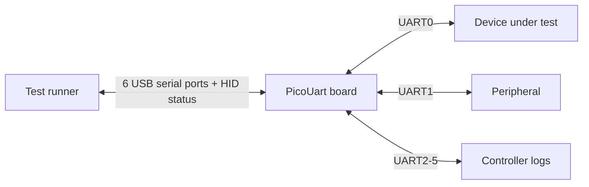

# PicoUart

[](https://github.com/djwinter29-oss/PicoUart/actions/workflows/pr-check.yml)
[](https://github.com/djwinter29-oss/PicoUart/actions/workflows/release.yml)
[](LICENSE)

**Six UARTs. One Pico. One USB cable.** PicoUart turns a Raspberry Pi Pico or Pico 2 into six independent USB serial
ports, with host applications that monitor UART status and bridge health alongside your serial traffic. Built for
multi-device bring-up, test automation, and diagnosing failed test runs.

[Download firmware](https://github.com/djwinter29-oss/PicoUart/releases) ·
[Hardware setup](docs/hardware-setup.md) ·
[Test automation](#test-automation)

| Raspberry Pi Pico | Raspberry Pi Pico 2 |
| :---: | :---: |
|  |  |
| RP2040 · firmware: **`pico`** | RP2350 · firmware: **`pico2`** |

<details>
<summary>Board photo credits</summary>

Reference boards, not PicoUart-specific assemblies. Pico photo by Misael Reséndiz
([source](https://commons.wikimedia.org/wiki/File:Raspberry_Pi_Pico.jpg),
[CC BY-SA 4.0](https://creativecommons.org/licenses/by-sa/4.0/)); Pico 2 photo by SparkFun Electronics
([source](https://commons.wikimedia.org/wiki/File:DEV-26124-PICO-2-angle.jpg),
[CC BY 2.0](https://creativecommons.org/licenses/by/2.0/)).

</details>

## Why PicoUart?

**A USB-serial adapter moves bytes. PicoUart also shows what the bridge saw.**

| | What you get |
| --- | --- |
| **Six serial ports, one cable** | Standard USB serial ports for your terminals, scripts, and test runners. No host app is needed for UART data. |
| **Visibility beside the data** | Per-UART health, traffic counters, RX overrun flags, and buffer peaks on a separate HID interface, apart from your serial ports. |
| **Test-automation friendly** | Save `pico-uart status --json` snapshots and `pico-uart monitor` logs next to each test run's results. |
| **Dashboards when you need them** | Watch all six UARTs live in the browser, local Python, or .NET app during bring-up and debugging. |


_Current WebHID layout with simulated telemetry; illustrative, not a live hardware result._

### When a test times out

A nightly test fails with an empty serial log. Was the device silent, or did bytes never get through? Serial logs alone
may not show where traffic stopped. Monitor PicoUart during the run and compare its dropped-byte counts before and
after, to see which UARTs carried traffic and whether the bridge reported an RX overrun. That gives you evidence
beyond the device's own messages.



Your test runner still owns sequencing and pass/fail; PicoUart adds bridge-level evidence, not automatic root-cause
detection.

## Get Started

1. **Get the firmware.** Download the rated **`pico`** or **`pico2`** firmware for your board from
   [Releases](https://github.com/djwinter29-oss/PicoUart/releases).
2. **Connect the hardware.** [Flash the firmware](docs/deployment/releasing.md#flashing-release-artifacts) and connect the board
    over USB. Check the [hardware setup](docs/hardware-setup.md) before connecting UART devices.
3. **Use the serial ports.** Open the port for the wired UART in your terminal or test script and set the baud rate and
   framing for the connected device.

## Test Automation

The Python CLI reads HID status while your serial tools keep using the UARTs. Install it with Python 3.10 or newer in a
virtual environment. Have your runner record dropped-byte counts before and after the test and run the monitor
alongside it:

```sh
python -m pip install --pre pico-uart
pico-uart overruns > overruns-before.txt
pico-uart monitor --duration 60 > uart-traffic.log
pico-uart overruns > overruns-after.txt
```

`--pre` selects development builds; omit it for stable releases. Each monitor line includes all six channels.
Illustrative excerpt showing one channel:

```text
seq=412 cdc0 health=0x11[ready,cdc_open] uart_tx/rx=96/1520 cdc_tx/rx=1520/96 ring_peak=64
```

These are traffic statistics, not UART payloads; capture device messages with your serial tools. Each monitor line's
byte counts are deltas since the previous report, saturating at 65535. The `overruns` counts are cumulative since boot,
so compare before and after.

`monitor` exits non-zero if it receives no valid reports. A successful exit does **not** mean every UART is healthy:
your runner must evaluate health flags and counts. Only `status` supports `--json`.

<details>
<summary>Python API: save a status snapshot</summary>

Call this helper from your test setup or teardown:

```python
import json
from pathlib import Path
from pico_uart import PicoUartHid

def save_uart_status(path: Path) -> None:
    with PicoUartHid() as board:
        status = board.read_status(timeout_ms=1000)
    if status is None:
        raise RuntimeError("no PicoUart status report received")
    path.write_text(json.dumps(status, sort_keys=True))
```

See the [Python guide](host/python/README.md) for the full API.

</details>

## Dashboards

Use a dashboard for interactive bring-up and diagnosis. Neither is needed for serial traffic.

### Browser Dashboard

Launch [WebHID](https://djwinter29-oss.github.io/PicoUart/), click **Connect**, and select your board.
No Python or .NET installation is needed.

> [!IMPORTANT]
> **WebHID requires desktop Google Chrome or Microsoft Edge.** Safari and Firefox are not supported.
> Connect the board to the computer running the browser. Linux may need
> [HID permissions setup](tools/README.md#linux-hid-permissions).

See the [WebHID guide](host/webhid/README.md) for controls and connection troubleshooting.

### Local Python Dashboard

With the [pico-uart](https://pypi.org/project/pico-uart/) package installed as above, run `pico-uart web` and open
`http://127.0.0.1:5000/`. It does not require browser WebHID support. See the [Python guide](host/python/README.md) for
`pipx` and device permissions. Prefer .NET? See the [.NET host guide](host/dotnet/README.md).

## Before You Connect

- UART0-1 use hardware UARTs; UART2-5 use PIO and support **8N1 only**.
- RTS/CTS flow control is disabled by default. Throughput is shared across USB full-speed bandwidth; configured baud
  is not a guarantee of sustained six-port throughput.
- Dashboards use HID for diagnostics and limited controls; serial applications use CDC for UART data and line settings.
- The USB identity `cafe:4010` is for development/lab use, not commercial derivatives. See [SECURITY.md](SECURITY.md).

## Documentation

| Need | Guide |
| --- | --- |
| Connect UART devices | [Hardware setup](docs/hardware-setup.md) |
| Understand USB and UART behavior | [CDC/HID overview](docs/design/usb/cdc-hid-overview.md), [architecture](docs/design/architecture.md) |
| Build or modify firmware | [Firmware build guide](firmware/build-and-config.md), [development and testing](docs/development/firmware-testing.md) |
| Develop host applications | [Host development](docs/development/host-tools.md), [distribution plan](docs/development/host-distribution.md) |
| Publish or test a release | [Release workflows and qualification](docs/deployment/releasing.md) |
| Contribute | [Contributing](CONTRIBUTING.md), [Code of Conduct](CODE_OF_CONDUCT.md) |

Firmware is checked on a physical fixture ([test records](docs/tests/README.md)). Host tests do not replace hardware
qualification; results apply only to the exact artifacts and conditions recorded.

## License

[BSD 3-Clause](LICENSE).

