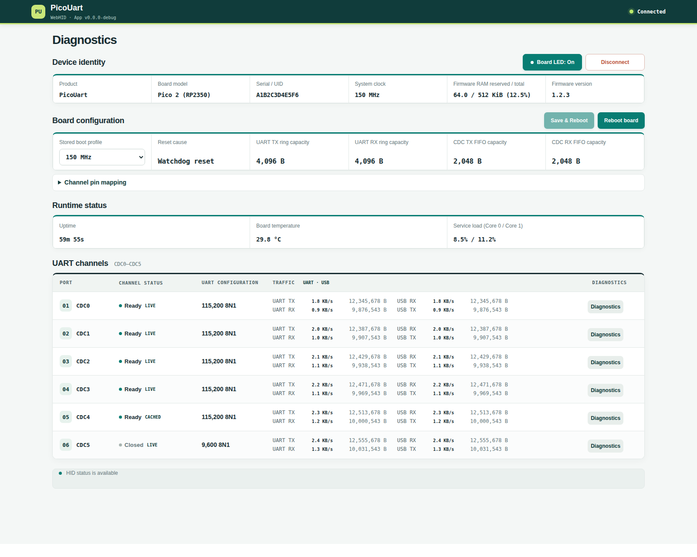
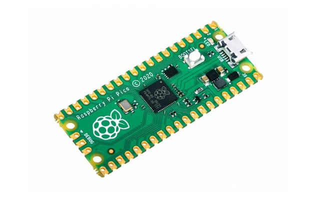
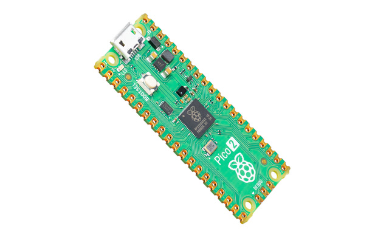

# PicoUart

[](https://github.com/djwinter29-oss/PicoUart/actions/workflows/pr-check.yml)
[](https://github.com/djwinter29-oss/PicoUart/actions/workflows/release.yml)
[](LICENSE)


**Six serial ports. One Pico. Diagnostics built in.**

PicoUart turns a stock Raspberry Pi Pico or Pico 2 into a six-port USB-to-UART bridge for bring-up benches and test
racks. Replace a tangle of single-port adapters with one board and one USB cable, keep your existing terminals and
scripts, and inspect bridge health without closing your serial connections.

**Quick links:** [Download firmware](https://github.com/djwinter29-oss/PicoUart/releases) ·
[Hardware setup](docs/hardware-setup.md) ·
[Open browser dashboard](https://djwinter29-oss.github.io/PicoUart/) ·
[Python package](https://pypi.org/project/pico-uart/)

## Why PicoUart?

A silent serial log is ambiguous: did the device stop talking, did the bridge drop bytes, or did the host stop
reading? A typical USB-serial adapter can't tell you which. PicoUart counts traffic on both sides of the bridge, per
channel, to help narrow down where traffic stopped. These counters provide evidence, not automatic root-cause
detection; your test runner still decides pass or fail.

| | What you get |
| --- | --- |
| **Six ports, one cable** | Six independent standard USB serial ports from a single Pico. No host app needed for data. |
| **Independent diagnostics** | UART/USB traffic counters, RX dropped-byte counts, and buffer peaks over separate USB HID. |
| **Evidence for CI** | Save JSON status snapshots and timed traffic logs next to your test results. |
| **Browser dashboard** | Desktop Chrome/Edge; Linux may need [HID permissions](tools/README.md#linux-hid-permissions). |

One host, six UART devices (logical connections, not a wiring diagram):

```text
Computer -- USB -- Pico / Pico 2 -- UART0 -- Device A
                               |- UART1 -- Device B
                               |- UART2 -- Device C
                               |- UART3 -- Device D
                               |- UART4 -- Device E
                               `- UART5 -- Device F
```



_Current WebHID layout with simulated telemetry; illustrative, not a live hardware result._

## Before You Connect

- **Electrical limits:** use 3.3 V UART logic and a shared ground. Never connect 5 V or RS-232 signals directly.
- **Framing:** UART0-1 use hardware UARTs; UART2-5 use PIO and support **8N1 only**.
- **Flow control:** RTS/CTS is disabled by default.
- **Throughput:** all six channels share USB full-speed bandwidth. A configured baud rate is not a guarantee of
  sustained throughput; use the [dated hardware test results](docs/tests/records/README.md) to choose tested conditions.
- **Clock settings:** non-default profiles require explicit overclock acknowledgement. Stability is board-specific;
  passing tests on one board does not qualify another.

Serial applications use USB CDC for UART data, baud rate, and framing. Dashboards use the separate HID interface for
diagnostics and limited board controls.

## Get Started

1. **Download firmware** from [Releases](https://github.com/djwinter29-oss/PicoUart/releases): choose the **`pico`**
   `.uf2` for Pico (RP2040) or **`pico2`** `.uf2` for Pico 2 (RP2350). These images target non-wireless boards; see
   [Hardware Compatibility](#hardware-compatibility) for W variants.
2. **Flash the board** using the [USB-drive flashing guide](docs/deployment/releasing.md#usb-drive-uf2).
   You need a USB cable, not a debug probe.
3. **Wire a UART device:** connect TX to the device's RX, RX to its TX, and ground to ground. Follow the
   [pin map and wiring rules](docs/hardware-setup.md) and observe the 3.3 V limit.
4. **Open the matching serial port** in your terminal or test script. Use the
   [port identification guide](docs/hardware-setup.md#find-the-serial-ports), then set baud rate and framing for your
   device.
5. **Check diagnostics (optional):** open the [browser dashboard](https://djwinter29-oss.github.io/PicoUart/) in desktop
   Chrome or Edge, click **Connect**, and select your board.

**Setup checkpoint:** the host should list six PicoUart serial ports. That confirms USB enumeration, not UART wiring.
Confirm communication by exchanging expected data with your connected device at its required baud rate and framing.

If device access is denied, check OS permissions. Linux HID access uses the
[permissions setup](tools/README.md#linux-hid-permissions); CDC serial-port permissions are separate.

## Test Automation

The optional Python CLI reads diagnostics while your serial tools use the UARTs. With Python 3.10 or newer, follow the
[installation guide](host/python/README.md#quick-start), then record a status snapshot or a timed traffic log:

```sh
pico-uart status --json > uart-status.json
pico-uart monitor --duration 60 > uart-traffic.log
pico-uart overruns > uart-dropped-bytes.txt
```

These commands collect diagnostics; they do not start a serial test or capture UART payloads. Run your serial test
separately during monitoring. To measure dropped bytes for a run, record `overruns` before and after it and account for
any board reset.

A successful command does **not** prove that every channel is healthy or that reporting was continuous. Your runner
must evaluate the returned states and counters. Use one HID monitor per physical board; separate processes do not
share input reports.

See the [Python guide](host/python/README.md) for the API, output semantics, and multi-board selection.

## Dashboards

Choose the interface that fits your workflow. All three show bridge diagnostics; none is required for serial traffic.

| Dashboard | Choose it when |
| --- | --- |
| [Browser](#browser-dashboard) | You want browser-only access. |
| [Python](#local-python-dashboard) | You also want the Python API or CLI. |
| [.NET](#local-net-dashboard) | You prefer a self-contained executable. |

All three need local USB access to the board; Linux may require
[HID permissions setup](tools/README.md#linux-hid-permissions).

### Browser Dashboard

Open [WebHID](https://djwinter29-oss.github.io/PicoUart/), click **Connect**, and select your board.
No application installation is needed.

> [!IMPORTANT]
> **WebHID requires desktop Google Chrome or Microsoft Edge.** Safari and Firefox are not supported.

See the [WebHID guide](host/webhid/README.md) for controls and connection troubleshooting.

### Local Python Dashboard

Install [pico-uart](https://pypi.org/project/pico-uart/), run `pico-uart web`, and open <http://127.0.0.1:5000/>.
It works without browser WebHID support. See the [Python guide](host/python/README.md) for installation and device
permissions.

### Local .NET Dashboard

Download a self-contained host from [Releases](https://github.com/djwinter29-oss/PicoUart/releases), extract the whole
archive, and run `./PicoUart web` on Linux/macOS or `.\PicoUart.exe web` in Windows PowerShell. Open
<http://127.0.0.1:5000/>; no Python or .NET installation or browser WebHID support is required.
See the [.NET host guide](host/dotnet/README.md) for supported downloads and device permissions.

## Hardware Compatibility

The prebuilt **`pico`** and **`pico2`** firmware images target the standard non-wireless boards:

<table align="center">
    <thead>
        <tr>
            <th scope="col" align="center">Raspberry Pi Pico</th>
            <th scope="col" align="center">Raspberry Pi Pico 2</th>
        </tr>
    </thead>
    <tbody>
        <tr>
            <td align="center">
                
            </td>
            <td align="center">
                
            </td>
        </tr>
        <tr>
            <td align="center">RP2040 · firmware: <strong><code>pico</code></strong></td>
            <td align="center">RP2350 · firmware: <strong><code>pico2</code></strong></td>
        </tr>
    </tbody>
</table>

Reference boards, not PicoUart-specific assemblies. See [photo credits](#photo-credits).

**Pico W and Pico 2 W:** use the matching `pico_w` or `pico2_w`
[board-specific build](firmware/build-and-config.md#build) for USB/UART operation. Wi-Fi and Bluetooth are not enabled.
See the [wireless-board notes](docs/hardware-setup.md#wireless-boards) for the LED limitation and qualification scope.

**PicoUART6 carrier:** the default UART TX/RX pinout matches
[8086net/pico-sexa-uart-bridge](https://github.com/8086net/pico-sexa-uart-bridge) and the PicoUART6 hardware sold on
[Lectronz](https://lectronz.com/products/picouart6) and [The Pi Hut](https://thepihut.com/products/picouart6).
Carrier-board LEDs and USB-to-I2C are not supported; see the
[compatibility notes](docs/hardware-setup.md#picouart6-carrier-compatibility) before using it.

## Documentation

| Need | Guide |
| --- | --- |
| Connect UART devices | [Hardware setup](docs/hardware-setup.md) |
| Use the CLI, API, or dashboards | [Python](host/python/README.md), [.NET](host/dotnet/README.md), [WebHID](host/webhid/README.md) |
| Understand USB and UART behavior | [CDC/HID overview](docs/design/usb/cdc-hid-overview.md), [architecture](docs/design/architecture.md) |
| Build or modify firmware | [Firmware build guide](firmware/build-and-config.md), [development and testing](docs/development/firmware-testing.md) |
| Develop host applications | [Host development](docs/development/host-tools.md), [host app distribution](docs/deployment/host-app-distribution.md) |
| Understand PR and release checks | [GitHub Actions: validation and releases](docs/development/github-actions.md) |
| Publish or test a release | [Release qualification](docs/deployment/releasing.md), [host publishing](docs/deployment/host-app-publishing.md) |
| Review validation and hardware evidence | [Test guide](docs/tests/README.md), [dated HIL records](docs/tests/records/README.md) |
| Contribute | [Contributing](CONTRIBUTING.md), [Code of Conduct](CODE_OF_CONDUCT.md) |

Firmware is checked on a physical fixture ([test records](docs/tests/README.md)). Host tests do not replace hardware
qualification; results apply only to the exact artifacts and conditions recorded.

## License

[BSD 3-Clause](LICENSE).

The USB identity `cafe:4010` is for development/lab use, not commercial derivatives. See [SECURITY.md](SECURITY.md).

## Photo Credits

Pico photo by Misael Reséndiz
([source](https://commons.wikimedia.org/wiki/File:Raspberry_Pi_Pico.jpg),
[CC BY-SA 4.0](https://creativecommons.org/licenses/by-sa/4.0/)); Pico 2 photo by SparkFun Electronics
([source](https://commons.wikimedia.org/wiki/File:DEV-26124-PICO-2-angle.jpg),
[CC BY 2.0](https://creativecommons.org/licenses/by/2.0/)).
