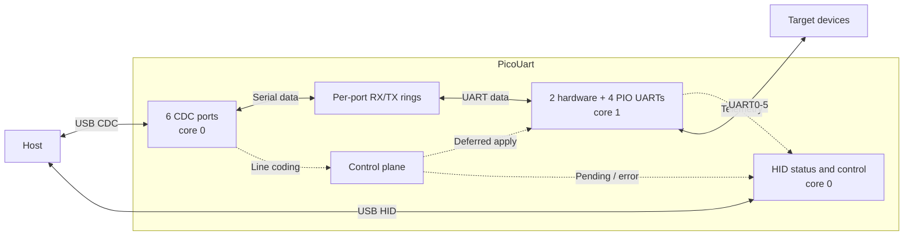
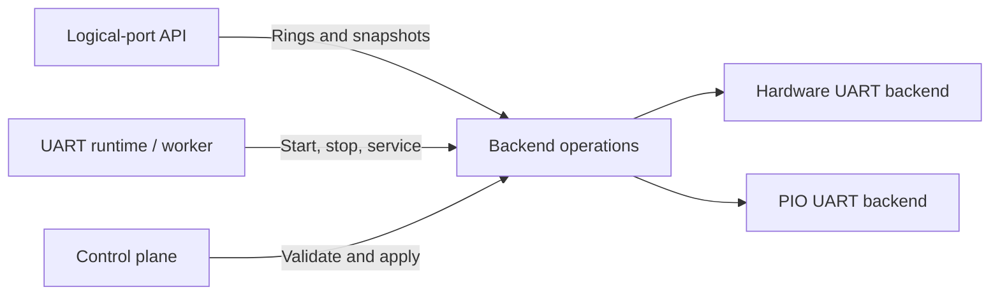

# Architecture

PicoUart is a composite USB device with six CDC ACM serial ports and one vendor HID interface. Each CDC port is bridged
to one UART. UART0-1 run on the chip's hardware UARTs, and UART2-5 run on PIO state machines.

Solid lines carry UART bytes. Dashed lines carry configuration and telemetry only. Baud rate and framing are set
via CDC; HID only reports what was applied.

## Design Principles

- **One core per side.** Core 0 owns TinyUSB and the USB side of the bridge. Core 1 owns all UART hardware. Neither
  core calls into the other's private state.
- **Rings are the data boundary.** Every port has one TX ring (USB to UART) and one RX ring (UART to USB). Each ring has
  exactly one producer and one consumer.
- **Configuration is deferred, never in-line.** A line-coding change is handed to core 1, which applies it only at a
  safe point. Core 0 never touches UART hardware.
- **Diagnostics are separate from data.** HID reports health and counters without competing with serial traffic.
- **Board pinout is data, not code.** A constant board table selects pins and the backend for each port, and the
  transport and lifecycle code never hard-codes pins.

## Component Map

| Component | Responsibility | Design |
| --- | --- | --- |
| CDC and HID | USB interfaces, DTR lifecycle, byte admission, reports | [CDC/HID overview](usb/cdc-hid-overview.md) |
| Rings | Per-port buffering, overflow and backpressure policy | [Ring buffers](uart/ring-buffer-design.md) |
| Control plane | Line-coding hand-off, deadlines, error reporting | [Control plane](control-plane-design.md) |
| Backend operations | Common contract for both UART implementations | [Backend contract](uart/backend-adapter-design.md) |
| Hardware UART | PL011 with RX/TX DMA | [Hardware UART](uart/hardware-uart-design.md) |
| PIO UART | PIO state machines with RX DMA and hybrid TX | [PIO UART](uart/pio-uart-design.md) |
| HID protocol | Report layouts, states, and board actions | [HID report reference](usb/hid-report-reference.md) |

## Inter-Core Coordination

Coordination uses a small set of mechanisms, each with a single job. They rely on RP2040/RP2350 guarantees (atomic
aligned 32-bit access and SDK memory barriers) rather than portable C11 threading.

### Ring Ownership

Rings are single-producer/single-consumer. The producer publishes payload before advancing its cursor, and the consumer
retires bytes only after reading them, with `__dmb()` barriers between. Rings take no locks, so the data path never
waits on status reads.

### Control Mailbox

Each port has one mailbox slot for line-coding requests. Core 0 fills the slot under the shared status lock. Core 1
takes it and records that it now owns the request in the same lock hold, so there is never a moment when a request
has no owner. An empty mailbox therefore does not mean the change is done; core 1 may still be waiting for a safe apply
point. Ports never block each other's mailboxes.

### Status Lock

The status lock protects the small shared state that both cores read: lifecycle flags, control ownership, request
generations, and applied settings. It does not protect ring cursors.

### Telemetry Snapshots

Core 1 brackets each statistics update with an odd/even sequence counter. Core 0 accepts a snapshot only if the counter
is even and unchanged across the read, so HID never reports a half-written update.

### Worker Heartbeat and Startup

Core 1 bumps a heartbeat after each full control-and-I/O pass. Core 0 feeds the watchdog only while the heartbeat keeps
moving, so a wedged UART worker triggers a reboot instead of failing silently.

Startup is all-or-nothing. Every configured backend must initialize, or the ones already started are rolled back and
the worker is not launched. Core 1 is explicitly reset before launch, so startup never depends on the state a debugger
or earlier boot left behind.

## Constraints

- PIO UARTs support 8N1 only. Hardware UARTs accept the wider CDC framing set.
- Each active UART holds one RX and one TX DMA channel, so six ports use all 12 RP2040 DMA channels.
- All six ports share one USB full-speed link (12 Mbit/s). For example, six full-duplex 3 Mbaud streams would need
  3.6 MB/s, more than USB can carry. An accepted baud rate is a per-port setting, not a throughput guarantee.
- RTS/CTS flow control is off by default and enabled per backend in the board configuration.
- Multicore, DMA, and USB timing can only be proven on hardware; see the
  [HIL test plan](../tests/hil-fixture-test-plan.md).
