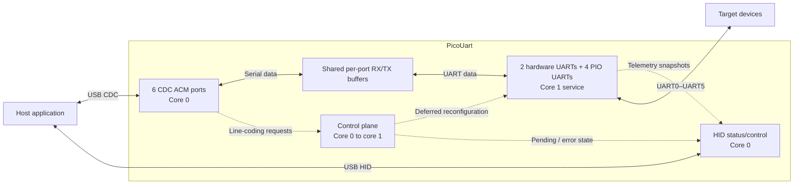
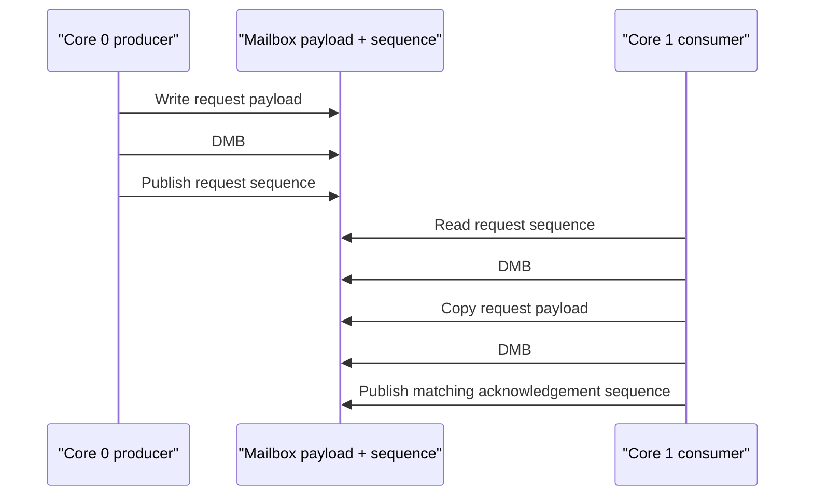

# Architecture

## System Boundary

PicoUart exposes six USB CDC ACM serial ports and one HID status/control interface. Each CDC port maps to one UART
channel. The current board configuration uses two hardware UARTs and four PIO UARTs; board-specific pin assignments
are documented in [Hardware Setup](../hardware-setup.md).

Solid paths carry UART bytes. Dashed paths carry configuration or telemetry, not payload data. UART line coding
originates on CDC; HID reports its outcome rather than configuring UART framing.

## Runtime Ownership

- Core 0 exclusively owns TinyUSB and USB-side bridge work.
- Core 1 owns steady-state UART backend service and applies deferred line-coding changes.
- Per-port RX/TX buffers move data between the USB and UART sides; HID reports status separately.
- Board configuration owns pin mapping; the UART subsystem owns runtime behavior.

The cores communicate through per-port rings, control mailboxes, and shared status; neither calls the other core's
private implementation.

## Inter-Core Coordination

These ownership and synchronization rules apply to the supported RP2040/RP2350 platforms.

### Ring Ownership

Per-port RX/TX direction and overflow behavior are defined in [Ring Buffer Design](uart/ring-buffer-design.md).

Aligned 32-bit cursor accesses are atomic on the supported RP2040/RP2350 platforms. Payload publication and cursor
retirement are ordered with Pico SDK `__dmb()` barriers. This is target-specific synchronization, not a portable C11
thread implementation. Ring ownership and DMA snapshot validation remain separate from status locking.

### Control Mailbox Ordering

Each UART port has its own single-producer/core-0 and single-consumer/core-1 mailbox slot. One port's unpublished
response does not block another port:

A mailbox slot remains owned until core 1 copies the request and publishes the matching acknowledgement sequence.
Acknowledgement releases the slot; it does not mean backend reconfiguration has finished. Core 1 can retain worker
ownership while waiting for a safe apply boundary, so `CONTROL_PENDING` and TX blocking may remain asserted after the
mailbox is empty. The handoff to worker ownership is coordinated under the status lock to avoid an unowned interval.
The complete pending-state and TX-blocking rules belong to [Control Plane Design](control-plane-design.md).

### Status Lock and Generations

The status lock protects core-0-visible flags, control ownership, generations, and metadata. It does not protect ring
cursors, which use SPSC ownership and barriers; keeping the mechanisms separate prevents status reads from becoming a
global data-path lock. Per-request generation behavior is described in [Control Plane Design](control-plane-design.md).

### Telemetry Sequence Counters

Core 1 brackets each stats update with an odd/even sequence and memory barriers. Core 0 accepts a snapshot only when the
sequence is even and unchanged across the read.

### Worker Heartbeat

The worker increments a heartbeat after each complete control-and-I/O step. Core 0 observes the counter through a
barrier and feeds the watchdog only while the counter has changed within the freshness window. A stale heartbeat causes
watchdog recovery rather than allowing a wedged core-1 UART worker to run unnoticed.

### Failure and Recovery Rules

Startup rollback, control completion, and RX overflow recovery are defined in the [UART subsystem](uart/README.md),
[Control Plane Design](control-plane-design.md), and [Ring Buffer Design](uart/ring-buffer-design.md). Physical DMA,
IRQ, and multicore timing require [hardware-in-the-loop testing](../tests/hil-fixture-test-plan.md).

## Constraints

- PIO UARTs support 8N1; hardware UARTs support the broader CDC line-coding set.
- Aggregate throughput depends on USB full-speed bandwidth and host drain rate; see the
  [HIL fixture plan](../tests/hil-fixture-test-plan.md) for measured results and test limits.
- Flow control is disabled by default. HID reset is enabled by default and can be removed at build time; see the
  [CDC/HID overview](usb/cdc-hid-overview.md) for interface behavior.

## Design Details

- [UART Subsystem](uart/README.md) is the entry point for backend architecture, buffers, control flow, and core
  ownership. It links to the focused ring-buffer, backend, PIO, and hardware UART design documents.
- [Control Plane Design](control-plane-design.md) describes CDC line-coding requests and HID error reporting.
- [HID Report Reference](usb/hid-report-reference.md) defines report fields and host compatibility.
- [Releasing PicoUart](../deployment/releasing.md) defines hardware qualification and artifact gates.
