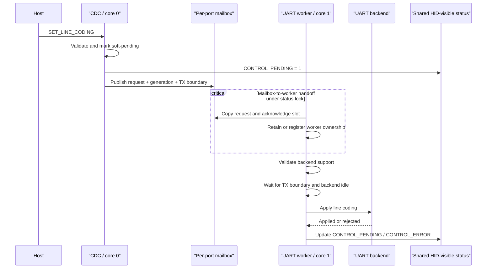

# Control Plane Design

This document describes PicoUart's UART control plane: how CDC line-coding requests move from TinyUSB on core 0 to UART
backend reconfiguration on core 1, and how failures are reported through HID health.

The data plane is documented separately in [Ring Buffer Design](uart/ring-buffer-design.md) and
[PIO UART Design](uart/pio-uart-design.md). The host-facing CDC/HID relationship is summarized in
[CDC/HID Overview](usb/cdc-hid-overview.md).

## Scope

The control plane handles CDC line-coding requests, not UART bytes. It coordinates USB-side validation with deferred
per-port backend application and reports pending or failed requests through HID. UART bytes remain on the RX/TX rings.

## Request Lifecycle

Valid requests move from USB-side pending to the per-port mailbox, then to worker ownership until the backend reaches a
safe apply boundary. Invalid or unsupported formats set `CONTROL_ERROR`. The worker applies a request only after TX has
drained to its captured boundary and backend-specific quiescence is satisfied.

Mailbox acknowledgement and worker-ownership changes must be atomic under the shared status lock. Otherwise a concurrent
reject or timeout could clear `CONTROL_PENDING` after mailbox acknowledgement but before worker ownership is visible,
allowing TX during an active format change. The worker also checks its deadline immediately before touching the backend,
so a late apply cannot report success after timeout.
Memory ordering and cross-core synchronization are defined in
[Architecture: Inter-Core Coordination](architecture.md#inter-core-coordination).

CDC hosts cannot rely on the USB control transfer result alone. TinyUSB may have already completed the request before
firmware applies or rejects it. Hosts must watch HID health bit 2 (`control_error`) and bit 3 (`control_pending`).

## Ownership States

`CONTROL_PENDING` remains set while any of the soft-pending, mailbox, or worker owners remain. It blocks admission of
new USB-to-UART bytes throughout that interval. Already-queued TX bytes may drain toward the captured old-format
boundary so reconfiguration can proceed, but draining that boundary alone does not clear pending state or admit new
bytes. Clear it only after all owners have completed; a newer reject must not unblock TX while an older apply is active.

Mailbox acknowledgement releases the slot, not the worker's deferred apply. Backend reconfiguration can still be
pending after the mailbox becomes empty.

The owners below are independent, not mutually exclusive states: a newer request may wait while an older request is
still worker-owned. The table describes transitions, not a replacement for the generation and locking rules.

| Event | Ownership transition | Required ordering and result |
| --- | --- | --- |
| Valid CDC request | Core 0 retains soft-pending ownership | Publish the new generation and pending status; block new TX ingress. Closed ports defer without consuming the staging timeout. |
| Mailbox submission | Soft-pending to mailbox ownership | Publish settings, generation, and captured TX boundary before releasing soft-pending ownership. |
| Worker takes mailbox | Mailbox to worker ownership | Acknowledge and register worker ownership in one status-lock hold; never expose an ownerless pending interval. |
| Deferred apply | Worker retains ownership | Drain the captured old-format TX boundary, require backend quiescence, and check the apply deadline before touching hardware. |
| Completion or timeout | Release the completing owner only | Publish applied metadata on success; clear pending only when no owner remains. Update error status only for the current generation. |
| Newer rejected request | Existing owners remain | Advance the generation and report error; an older valid apply may finish but cannot erase the newer error. |
| DTR close or USB session loss | Invalidate old-session ownership | Stop ingress, quiesce USB, then let the worker stop the backend and cancel old work. Preserve newer reopened requests. |

Native coverage lives in [control-plane tests](../../firmware/tests/test_control_plane.c),
[CDC callback tests](../../firmware/tests/test_usb_cdc.c), and the real CDC/driver/control integration target in
[facade tests](../../firmware/tests/test_uart_driver_facade.c). These inject handoff and lifecycle boundaries but do not
simulate concurrent cores or physical USB reset timing.

## Generations and Stale Completions

Each host control request increments a per-port generation. Completions carry the generation they belong to. A
completion may update `CONTROL_ERROR` only when its generation still equals the latest generation.

This prevents a stale successful completion from clearing an error reported for a newer rejected request. It also lets
an older valid request continue applying after a newer permanent reject; the older completion is no longer allowed to
erase the newer error.

## Timeouts

Soft-pending and worker application use separate bounded per-port deadlines; one busy port does not consume another
port's timeout. A valid request received while DTR is low remains deferred without consuming the mailbox timeout.
For startup, staging becomes eligible after the old stop handshake completes; hardware need not be active yet. Live
changes wait for backend readiness before mailbox submission. Repeating the
same eligible request does not extend its deadline indefinitely; a distinct replacement gets a new deadline. Timeout
reports `CONTROL_ERROR`; the configured duration is maintained in the control-plane implementation.

## USB Mount and Unmount Reset

USB mount and unmount clear host-facing CDC state, cancel soft-pending requests, and reset HID scheduling and reset-arm
state and stop backends belonging to old sessions. Polling detects lost TinyUSB mounted state because bus reset need
not invoke the unmount callback; remount cleanup also works without a prior unmount. Canceled requests must not later
produce timeout errors. Separately, a CDC DTR open-to-closed edge requests a
per-port close: USB core clears that interface's CDC FIFOs and pauses its bridge, then the UART worker deinitializes
only that backend. Queued bytes are discarded; applied line coding and cumulative counters are preserved, and the board
does not reboot. On the next open, the worker starts that backend and applies any deferred line-coding request before
the bridge resumes. Initial line coding is staged through the normal mailbox before the start request, so the worker
seeds baud/framing while stopped and enables the receiver using those settings, not the previous session's format.

## Lifecycle Invariants

- USB core owns DTR and byte admission. An old USB session loses ownership on close, unplug, bus reset, or remount.
- UART worker alone starts/stops backends. Stop completion requires USB quiescence; a newer lifecycle request wins.
- Mailbox take and worker ownership are atomic under the status lock, for startup as well as live changes.
- `READY` means the backend is active and its applied baud/framing metadata agrees with hardware. Startup failure
  leaves `READY` clear and prior applied metadata intact; a retry seeds a complete known configuration.
- USB startup admission progresses from `START_PENDING` through `STARTING` to `RUNNING`. Initial control errors or
  pending settings block both directions; live reconfiguration retains RX draining while TX ingress is blocked.
- Backend caches on stopped instances are staged values, not independently authoritative applied telemetry.
- The HID readiness deadline includes shared-lock acquisition and feature reads. Lock/transport failure cannot return
  success or leak the lock.

Close invalidates older control generations. Worker close completion preserves control requests received after reopen,
and a start completion cannot overwrite a newer close/open request or clear a newer control error. Each open makes one
backend start attempt; failure publishes `INIT_FAILED` instead of retrying indefinitely and blocking other ports' control
processing. Close and reopen to retry. Startup is serviced on the next worker sweep without a fixed DTR debounce,
cross-channel barrier, or fixture-specific startup order. Closed backends park TX idle-high, including hardware-UART
configuration-failure cleanup. Control service skips channels without `READY`, and idle channels avoid a second lock
pass and telemetry sequence-counter updates. One channel's startup or close cannot hold another channel's configuration.

CDC callbacks remain asynchronous. POSIX TTY `open()` does not guarantee backend initialization or applied line coding.
After opening and configuring a group, hosts can use Python `wait_channels_ready()` on the matching HID device to wait
for `READY`, DTR open, no `CONTROL_PENDING`, no current initialization/configuration error, and applied 8N1 settings
within 3% of the requested baud. The wait uses a shared deadline (3 seconds by default), reports current errors
immediately, propagates transport failures, and raises `TimeoutError` if readiness or matching settings never arrive.
Historical fault counters are not current configuration failures and do not by themselves fail this handshake.

## Host-Visible Rules

- `SET_LINE_CODING` may look successful to the host even when firmware rejects the request later.
- `CONTROL_PENDING` means soft-pending, mailbox, or worker ownership has not yet settled.
- `CONTROL_ERROR` means the most recent host control request failed, timed out, or was unsupported.
- Data transfer tests should include HID monitoring; clean byte transfer without clean HID health is incomplete
  evidence.

## Test Coverage

Host tests cover mailbox ownership, deadlines, stale completions, and TX blocking. CDC integration tests execute the
production callbacks with simulated time and UART/TinyUSB calls: delayed closed configuration, startup readiness,
identical retries, replacement requests, close/reopen, disconnect, and stale errors. A separate integrated build of the
existing facade harness links real CDC, driver, mailbox, and control-plane code against mocked backend/SDK edges; it
checks framing metadata before RX admission, startup failure followed by a mailbox-free retry, board-default startup,
and USB reset discarding old RX. These checks do not establish real
USB bus behavior, backend quiescence, or physical timing under load; those require hardware validation. See the
[HIL fixture plan](../tests/hil-fixture-test-plan.md).
