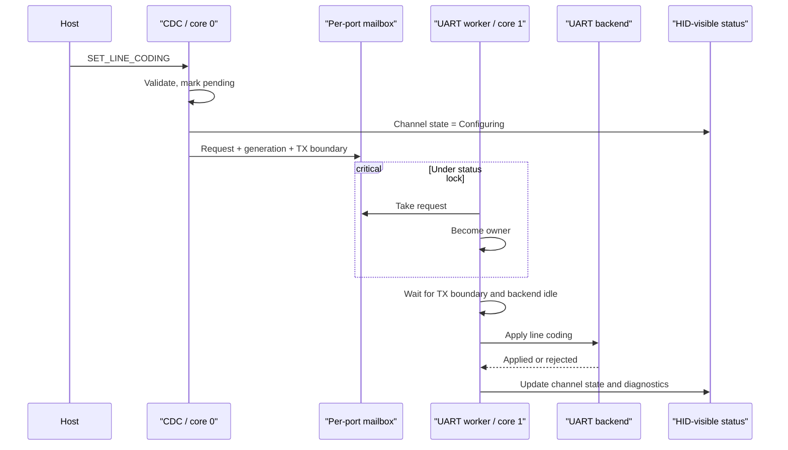

# Control Plane Design

The control plane carries CDC line-coding requests (baud rate and framing) from TinyUSB on core 0 to the UART backend
on core 1, and reports the outcome through HID. It never carries UART bytes.

## The Core Problem

TinyUSB acknowledges `SET_LINE_CODING` before the firmware can safely apply it. Applying a new format mid-frame, or
while old-format bytes are still queued, would corrupt traffic. So the firmware:

1. accepts the request immediately and blocks new TX bytes for that port,
2. lets bytes queued under the old format drain,
3. applies the change on core 1 once the backend is idle, and
4. reports the outcome through HID.

The USB transfer confirms receipt. HID reports `Configuring` while the change is pending and `Error` if it fails;
diagnostics retain the last configuration error reason.

## Request Lifecycle

A request remains `CONTROL_PENDING` from acceptance through completion, and new TX bytes are refused for that whole
interval. The status-lock hand-off keeps mailbox-to-worker ownership atomic.

Malformed or unsupported requests are rejected at once and set `CONTROL_ERROR`. Diagnostics retain the reason, such as
invalid framing on a PIO port or an unreachable baud rate.

## Generations and Stale Completions

Each request increments a per-port generation, and every completion carries its generation. A newer request may wait
while an older one is being applied. A completion updates `CONTROL_ERROR` only if its generation is still current, so
an older success cannot clear a newer error.

## Timeouts

A request for a closed port waits without starting its deadline. Soft-pending and worker application then have bounded
per-port deadlines, so a busy port never consumes another port's time. Repeating the same request does not extend its
deadline, but a different request gets a new one. A timeout sets `CONTROL_ERROR` and records its diagnostic reason.

## Port Lifecycle

DTR drives each port's lifecycle, and the UART worker is the only code that starts or stops a backend. HID reports
`Ready` when the backend is running and `Error` when initialization or configuration fails.

- **Open:** the initial line coding goes through the normal mailbox before the start request, so the backend starts
  with the requested format. Each open makes one start attempt. On failure the channel snapshot
  reports `Error`; close and reopen to retry.
- **Close:** core 0 stops admitting bytes and clears the port's CDC FIFOs. The worker then stops the backend and parks
  TX idle-high. Queued bytes are discarded, while the applied settings and boot-lifetime counters are kept. The board
  does not reboot.
- **Backend ready:** the backend is running and its reported settings match the hardware. Both directions
  are blocked until the port first becomes ready. During a later live reconfiguration, RX keeps draining and only TX
  is blocked.

One port's startup or close never holds up another port.

## USB Mount and Unmount Reset

Unplug, bus reset, and remount end the old USB session. The firmware clears host-facing CDC state, cancels soft-pending
requests without reporting them as timeouts, resets HID scheduling and reset-arm state, and stops the old session's
backends. A bus reset does not always fire TinyUSB's unmount callback, so the firmware also detects a lost mount by
polling.

## Host Guidance

- Opening a serial port does not guarantee the backend is running or the line coding is applied.
- After opening and configuring ports, wait for the HID channel snapshot to report `Ready` with the expected applied
  settings. The Python client's `wait_channels_ready()` does exactly this.
- A `Ready` snapshot confirms the current state; read diagnostics separately when checking retained fault history.
