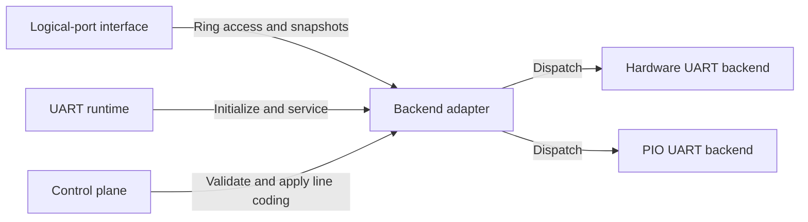

# UART Subsystem

This is the entry point for the UART subsystem. It summarizes the stable component boundaries; focused documents below
own backend and protocol details. [Architecture](../architecture.md) owns the system boundary, core responsibilities,
and system-wide constraints.

## Subsystem Boundary

The logical-port interface exposes byte transfer, readiness, and telemetry without exposing concrete backend state.
The UART runtime owns initialization, rollback, and worker orchestration. Both use a common backend adapter; the
control plane coordinates safe reconfiguration through that same boundary.

The board configuration selects the pin mapping and backend type. The UART subsystem owns runtime behavior and does not
own USB descriptors or board pin policy. Concrete backends own their hardware resources and ring storage; callers use
logical-port operations rather than reaching into backend-private state. The arrows above show responsibility and
dispatch, not physical signal flow.

## Focused Designs

- [Backend Adapter Design](backend-adapter-design.md): shared HW/PIO backend contract.
- [Hardware UART Design](hardware-uart-design.md) and [PIO UART Design](pio-uart-design.md): backend-specific behavior.
- [Control Plane Design](../control-plane-design.md): CDC line coding, deferred application, and HID error reporting.
- [Ring Buffer Design](ring-buffer-design.md) and
  [Inter-Core Coordination](../architecture.md#inter-core-coordination): data ownership and synchronization.

For host-facing USB behavior, see the [CDC/HID Overview](../usb/cdc-hid-overview.md) and
[HID Report Reference](../usb/hid-report-reference.md). Host-test and hardware-validation boundaries are described in
the [firmware testing guide](../../development/firmware-testing.md).
