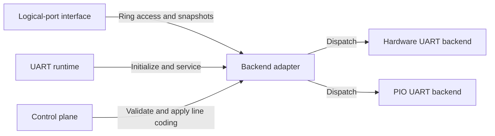

# UART Subsystem

This is the entry point for the UART subsystem. It summarizes the stable component boundaries; focused documents below
own backend and protocol details. [Architecture](../architecture.md) owns the system boundary, core responsibilities,
and system-wide constraints.

## Subsystem Boundary

The logical-port interface exposes byte transfer, readiness, and telemetry without exposing concrete backend state.
The UART runtime owns initialization, rollback, and worker orchestration. Both use a common backend adapter; the
control plane coordinates safe reconfiguration through that same boundary.

The board configuration selects the pin mapping and backend type. The UART subsystem owns runtime behavior and does not
own USB descriptors or board pin policy. Concrete backends own their hardware resources and ring storage; callers use
logical-port operations rather than reaching into backend-private state. The arrows above show responsibility and
dispatch, not physical signal flow.

## Source Navigation

- [UART driver](../../../firmware/src/uart/uart_driver.c): logical-port API, private state, lifecycle, and coherent
  telemetry snapshots. Port operations use the owned state directly rather than a second facade context.
- [Worker](../../../firmware/src/uart/worker.h): scheduling interface and heartbeat health policy.
- [Control plane](../../../firmware/src/uart/control/plane.c): deferred line-coding ownership and completion.
- [Hardware UART driver](../../../firmware/src/uart/hw/hw_uart_driver.c) and
  [PIO UART driver](../../../firmware/src/uart/pio/pio_uart_driver.c): hardware service and production SDK resource
  bindings. Resource-claim algorithms remain separate so rollback can be tested without the SDK.
- [Bridge](../../../firmware/src/uart/bridge.c) and
  [ring buffer](../../../firmware/src/uart/ring_buffer/ring_buffer.c): byte movement and buffer ownership.

Board pin configuration remains separate from transport and lifecycle code.

## Worker Startup

After all backend startup checks succeed and the backends are quiescent, core 0 explicitly resets core 1 with
`multicore_reset_core1()` before `multicore_launch_core1()`. This establishes the Pico SDK launch precondition rather
than relying on a preceding power-on or debugger reset to have left core 1 in the expected state. An already running
worker is neither reset nor relaunched by repeated driver initialization. Failed backend startup still rolls back
without launching the worker.

## Focused Designs

- [Backend Adapter Design](backend-adapter-design.md): shared HW/PIO backend contract.
- [Hardware UART Design](hardware-uart-design.md) and [PIO UART Design](pio-uart-design.md): backend-specific behavior.
- [Control Plane Design](../control-plane-design.md): CDC line coding, deferred application, and HID error reporting.
- [Ring Buffer Design](ring-buffer-design.md) and
  [Inter-Core Coordination](../architecture.md#inter-core-coordination): data ownership and synchronization.

For host-facing USB behavior, see the [CDC/HID Overview](../usb/cdc-hid-overview.md) and
[HID Report Reference](../usb/hid-report-reference.md). Host-test and hardware-validation boundaries are described in
the [firmware testing guide](../../development/firmware-testing.md).
