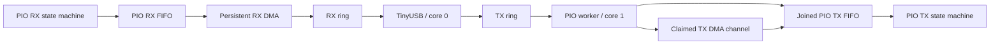
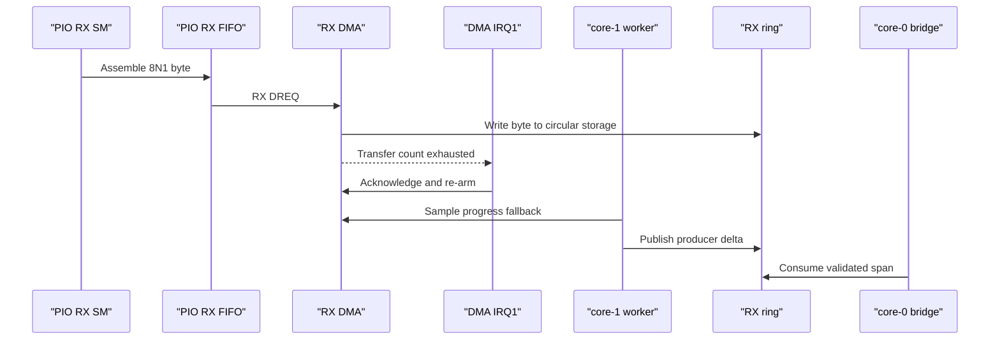
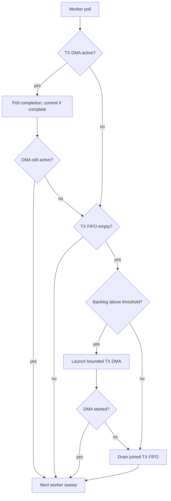
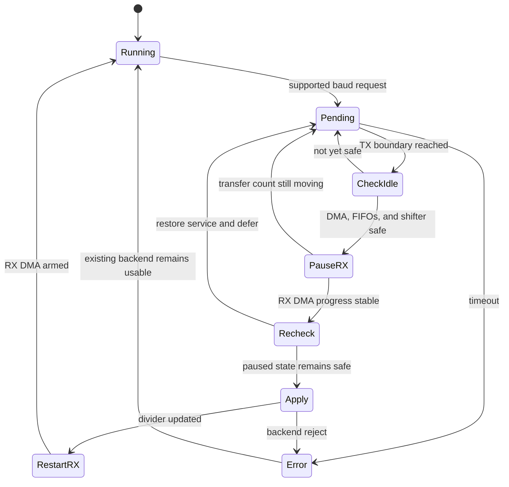

# PIO UART Design

This document describes the PIO UART backend used for logical UART ports 2-5. It focuses on the current runtime design:
core ownership, RX DMA, hybrid TX, flow-control hooks, and safe baud-rate changes.

For shared ring semantics, see [Ring Buffer Design](ring-buffer-design.md). For host-visible status bits, see
[HID Report Reference](../usb/hid-report-reference.md).

## Ownership Model

- Startup initializes the backends before the UART worker starts.
- Initializing an already-active PIO instance is rejected before any resource or ring state changes; deinitialize it
  before starting it again. This preserves existing DMA channels and state-machine ownership on accidental retries.
- During steady-state operation, core 0 owns TinyUSB and moves bytes between CDC endpoints and per-port rings.
- Core 1 services PIO state machines, DMA channels, TX/RX, and deferred backend changes.
- RX and TX rings are the only data-plane contract between USB code and the PIO backend.

This keeps TinyUSB isolated from hardware service details and preserves one producer and one consumer for each ring
direction.

## RX Path

PIO RX is DMA-backed. Each PIO RX state machine assembles UART bytes into its RX FIFO, and a persistent DMA channel
writes those bytes into the matching RX ring. Core 1 publishes DMA progress into the ring producer sequence and re-arms
the RX DMA transfer when needed.

Important details:

- The PIO RX program uses a 3-sample majority vote on every bit (8 data bits plus the stop bit) at its own 32 PIO
  clocks/bit ratio, independent of TX's 8 clocks/bit divider. The samples are four PIO clocks apart, at centre-4,
  centre, and centre+4, so the vote still covers a quarter of the bit. The clean stop path arms `wait 0 pin` 9 PIO
  cycles before the next start bit. RX and TX run on separate state machines with separate clock dividers, so this does
  not change TX bit timing. When the first two samples agree, the bit is resolved without taking the third sample.
- The RX pin keeps the PIO input synchronizer. Two `clk_sys` cycles are 16 ns at 125 MHz, about 1.5 RX clocks at 3 Mbaud
  on this 32-clock grid, inside the centre±4 sample offset. The synchronizer handles asynchronous input sampling;
  majority voting rejects isolated sample errors. Neither establishes immunity to arbitrary noise or invalid timing.
- PIO and hardware UART TX pins use fast slew and 12 mA drive. Actual edge quality depends on the board, wiring, and
  load; majority voting does not compensate for inadequate signal integrity. Validate the intended setup in hardware.
- TX uses an 8-clock-per-bit side-set program. Back-to-back 8N1 frames take 10 bit-times, and the stop bit is the
  initial idle-high hold at the next frame boundary. The 32-clock RX vote arms its next-start wait 9 PIO cycles before
  a 1-stop peer's next start; divider limits and sampling timing are specific to this design. These cycle counts do not
  establish sustained throughput; measured results belong in the [HIL record archive](../../tests/records/README.md).
- The IN shift is configured so LSB-first UART samples form a natural byte in FIFO bits `[31:24]`; RX DMA reads one byte
  from `rxf+3`.
- RX DMA transfer counts use the SDK encoder so RP2350 does not enter ENDLESS mode.
- Stop-bit framing errors are sticky per port and visible as HID health bit 7.
- If the host does not drain CDC fast enough, shared ring overflow accounting records overwritten RX bytes.

RX DMA re-arm is handled from DMA IRQ1 on the UART worker core, with the worker poll path as a safety net.

## TX Path

PIO TX is hybrid. During each per-port service pass, core 1:

1. Polls any active TX DMA and commits its owned span when complete; if DMA remains active, returns.
2. Waits for previously queued TX FIFO data to drain before adding another transfer budget.
3. Attempts bounded DMA for a sufficiently large backlog; otherwise drains a bounded span into the joined TX FIFO.
  If DMA cannot be launched, the same pass falls back to FIFO writes.

Both polling and DMA feed the same TX FIFO; the state machine serializes its bytes onto the pin. The backlog threshold
and transfer budget are tuning policy, not part of the host-visible protocol or a throughput guarantee.

Each initialized PIO port claims its TX DMA channel once during init and holds that channel until deinit. A launch
reuses the claimed channel; it does not claim or release a channel per transfer. Fixed DREQ, transfer size, increment
settings, and FIFO destination are programmed once at startup. Launches update only the source address and transfer
count; ordinary completion keeps the channel enabled. Deinit aborts and releases it, and a later startup configures it
again. If a launch does not start, the same
sweep drains the FIFO instead. While TX DMA is active, it owns its reserved TX-ring span; that span is committed only
after DMA completion. The channel stays claimed. DMA completion frees ring storage but does not prove the FIFO and
output shifter are idle; baud changes require those additional checks.

## Why TX Is Hybrid

The joined PIO TX FIFO is small compared with sustained USB-originated bursts across multiple ports. Pure polling wastes
worker time under backlog, but pure DMA wastes setup cost on tiny writes. The hybrid policy keeps short bursts simple
and uses DMA only when queued work is large enough to amortize setup.

## Flow-Control Pins

PIO RTS/CTS support is opt-in through board pin flags:

- `PIO_UART_DRIVER_PIN_FLAG_RX_FLOW_CONTROL`: drives active-low RTS from RX-ring occupancy.
- `PIO_UART_DRIVER_PIN_FLAG_TX_FLOW_CONTROL`: gates TX frame starts on active-low CTS. Asserted (low) permits a new
  frame; deasserted (high) extends idle-high between frames without truncating a frame already in progress.
- `PIO_UART_DRIVER_PIN_FLAG_RX_PULL_UP`: enables a pull-up on RX during backend initialization.
- `PIO_UART_DRIVER_PIN_FLAG_REQUIRE_RX_IDLE_HIGH`: requires idle-high RX before a deferred baud change.

The default board configuration leaves PIO RTS/CTS disabled. Do not claim lossless RX behavior without testing the
relevant flow-control variant.

## Line-Coding Changes

PIO UART ports remain 8N1-only. Unsupported parity, data-bit, or stop-bit requests are rejected and reported through HID
`control_error`. Supported baud changes are deferred until the worker core can reach a safe boundary.

The [control plane](../control-plane-design.md) blocks new USB-to-UART admission while the request is pending and waits
for the captured old-format TX boundary to drain. Before applying a PIO baud change, core 1:

1. Publishes observed RX progress and polls TX DMA completion.
2. Requires TX DMA to be inactive and TX FIFO to be empty. A nonblocking probe clears an observed sticky TXSTALL flag
  once, defers to another worker sweep, and accepts idle only when the flag reasserts. RX must also be at its next-start
  wait with an empty FIFO; ports configured for the idle-high gate must have RX high.
3. Pauses RX DMA and waits for a stable transfer count. If settling fails, resumes DMA and defers the change.
4. In a short critical section, publishes the stable RX position, stops and acknowledges DMA, pauses the state machines,
  and rechecks FIFO and RX-idle conditions. A failed recheck restores service and defers the change.
5. Applies the new TX/RX dividers, restarts the state machines, and resumes RX DMA from the live producer position,
  preserving unread ring data. The control plane bounds retries with its per-port deadline.

The TXSTALL probe never spins waiting for the PIO clock. Slow-baud reassertion is observed across worker sweeps, so
sibling ports remain serviceable while the control-plane deadline still bounds the request. New FIFO or DMA TX work
invalidates the probe; startup, deinit, and baud application reset it. No stale pre-transmission flag can establish
idle. RX DMA settling and the critical FIFO/quiescence recheck remain unchanged. The RX idle-high gate prevents
changing the divider mid-frame for boards that can guarantee idle-high RX through pull-up.

Host tests cover the fresh-evidence probe state transitions, including delayed reassertion and invalidation by new TX.
Driver-level TX regressions compile the real PIO driver with mocked SDK register calls and real ring-buffer code.
They exercise FIFO/DMA launches, probe invalidation before hardware writes, busy-transfer ownership, completion,
relaunch without repeated channel configuration, and source-address changes across ring wrap. TXSTALL write-one-clear
and reassertion are explicitly modeled by the test; physical register timing is not simulated or qualified.
Reduced per-launch setup and removal of the baud-dependent busy-wait do not establish measured throughput or latency
improvements. Requalify low-baud changes with simultaneous sibling-port traffic and DMA completion/relaunch on hardware.

## Observability

The backend tracks TX bytes sent through polling and DMA. The compact HID input report exposes aggregate controller
TX/RX byte deltas and per-channel health; it does not distinguish PIO poll TX from PIO DMA TX.

Relevant host-visible signals:

- HID health bit 2: control request failed or timed out.
- HID health bit 3: control request is pending.
- HID health bit 5: backend is PIO.
- HID health bit 6: RX data has been overwritten.
- HID health bit 7: PIO stop-bit framing error. After all backends initialize and before the worker starts, startup
  clears the bring-up error baseline without counting it as a runtime fault. Subsequent framing-error observations
  remain visible through diagnostics.
- HID overflow-count feature report: cumulative UART-to-USB RX dropped bytes.

## Current Limits

- PIO UART framing is 8N1 only.
- PIO baud rates must be representable by both the TX and RX PIO clock dividers and are rejected fail-fast otherwise.
  TX's 8x ratio hits the divider ceiling first at very low baud; RX's 32x ratio hits the divider floor first at very
  high baud.
- PIO instruction memory is finite. Backend initialization checks whether the selected programs fit and rejects a
  configuration that exceeds the available space.
- Each worker step services every port. Deferred control and backend polling start on the same port in that step. The
  shared start index advances once, after the I/O sweep. There is no separate TX priority scheduler.
- Sustained multi-port throughput depends on USB full-speed bandwidth and host drain rate. See the
  [HIL records](../../tests/records/README.md) for measured conditions and results, and the
  [HIL fixture plan](../../tests/hil-fixture-test-plan.md) for qualification procedures.

Flow-control behavior and sustained transport rates require board-specific HIL; do not infer those capabilities from
the configured baud or backend support alone.
