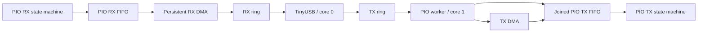

# PIO UART Design

UART2-UART5 are implemented with PIO state machines. Each port has its own RX and TX state machines. Core 1 services
them, along with their DMA channels and any deferred baud-rate change. Like the hardware backend, the PIO backend talks
to the USB side only through the port's rings.

## RX Path

The RX state machine samples each bit three times near its centre and takes a majority vote. The samples are four PIO
clocks apart on a 32-clock-per-bit grid. If the first two samples agree, the third is skipped. This filters isolated
sampling glitches; wiring and electrical load still determine signal quality.

A persistent DMA channel copies each assembled byte from the RX FIFO into the RX ring. A DMA interrupt on core 1 re-arms
the transfer, with the worker poll as a fallback.

Stop-bit framing errors are counted in the channel diagnostic `rx_error_count`.

## TX Path: Hybrid FIFO and DMA

The TX state machine runs at 8 clocks per bit. Each worker pass for a port:

1. checks any active TX DMA and commits its span once complete,
2. waits for the TX FIFO to empty before queuing more, then
3. uses DMA for a large backlog, or writes a small span straight into the FIFO. If DMA cannot start, it falls back to
   the FIFO.

**Why hybrid?** The joined TX FIFO is small compared with USB bursts across six ports. Polling alone wastes worker time
on a large backlog, while DMA alone wastes setup cost on tiny writes. The backlog threshold is an implementation
tuning value.

Each port claims its TX DMA channel once at startup and keeps it, so a launch only updates the source address and
length.

## Baud-Rate Changes

PIO ports are 8N1 only, so the only line-coding change they accept is a new baud rate. Changing the clock divider
mid-frame would corrupt data. The worker therefore applies a change only when both directions are provably idle:

```mermaid
stateDiagram-v2
  [*] --> Running
  Running --> Pending: supported baud request
  Pending --> CheckIdle: old TX bytes drained
  CheckIdle --> PauseRX: TX DMA, FIFOs, and shifter idle; RX waiting for start bit
  CheckIdle --> Pending: not yet idle
  PauseRX --> Recheck: RX DMA progress stable
  PauseRX --> Pending: still moving, resume
  Recheck --> Apply: still idle while paused
  Recheck --> Pending: restore service and defer
  Apply --> Running: dividers updated, RX DMA resumed at live position
  Pending --> Error: timeout
  Apply --> Error: backend reject
  Error --> Running: previous settings stay in use
```

- TX idle is proven with fresh evidence. The worker clears the TX state machine's stall flag, then waits for it to
  reassert on a later pass. It never busy-waits.
- The final check runs inside a short critical section, with the state machines and RX DMA paused. Any late activity
  restores service and defers the change. The control plane's deadline bounds the retries.
- The default configuration enables the RX pull-up and also requires RX to be idle-high before changing.

## Flow Control

RTS/CTS is opt-in and off by default. When enabled, RTS follows RX-ring occupancy and CTS gates the start of each TX
frame; an in-progress frame always finishes.

## Limits

- A baud rate must be representable by both dividers. TX (8 clocks per bit) hits the divider ceiling first at very low
  baud rates. RX (32 clocks per bit) hits the floor first at very high rates.
- PIO instruction memory is finite, and startup rejects configurations whose programs do not fit.
- The worker services every port on each pass, rotating the starting port. There is no separate TX priority scheduler.
- Sustained throughput depends on USB bandwidth and how fast the host drains data; baud configures each port.
  Measurements are in the [HIL records](../../tests/records/README.md#evidence-index).
