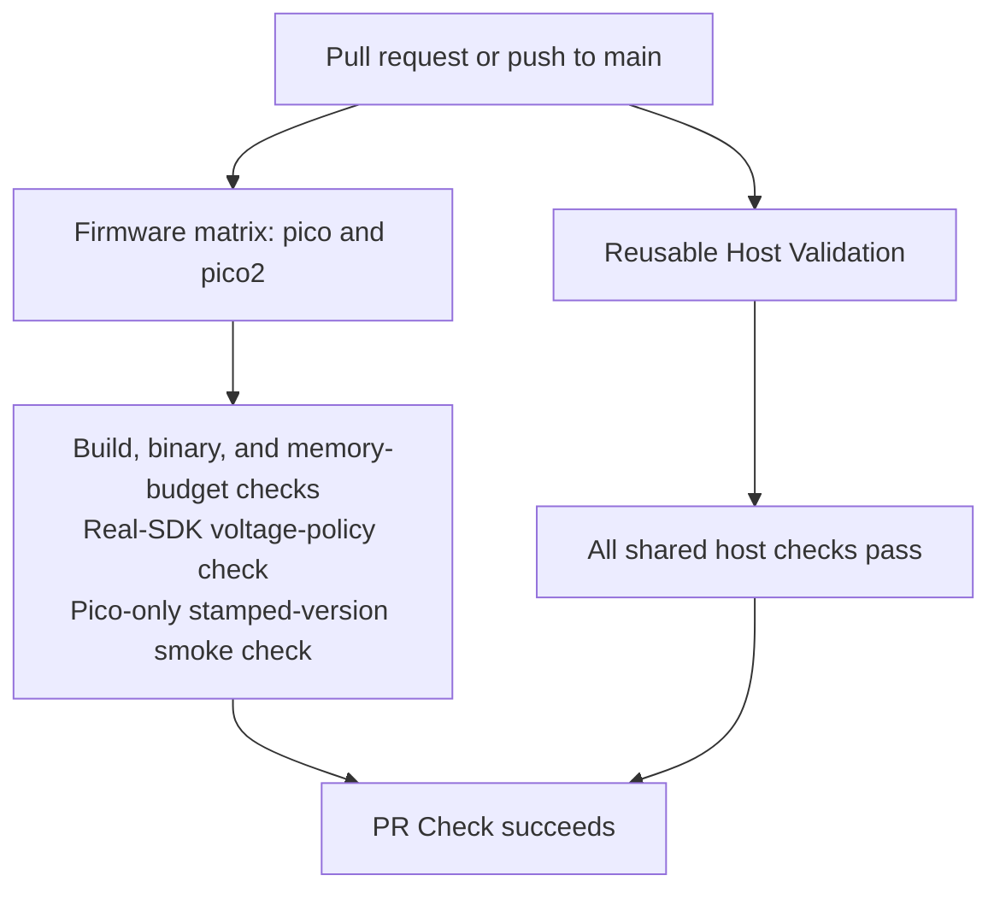
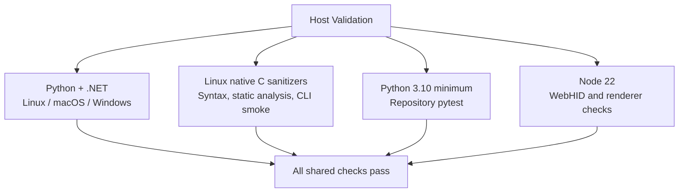
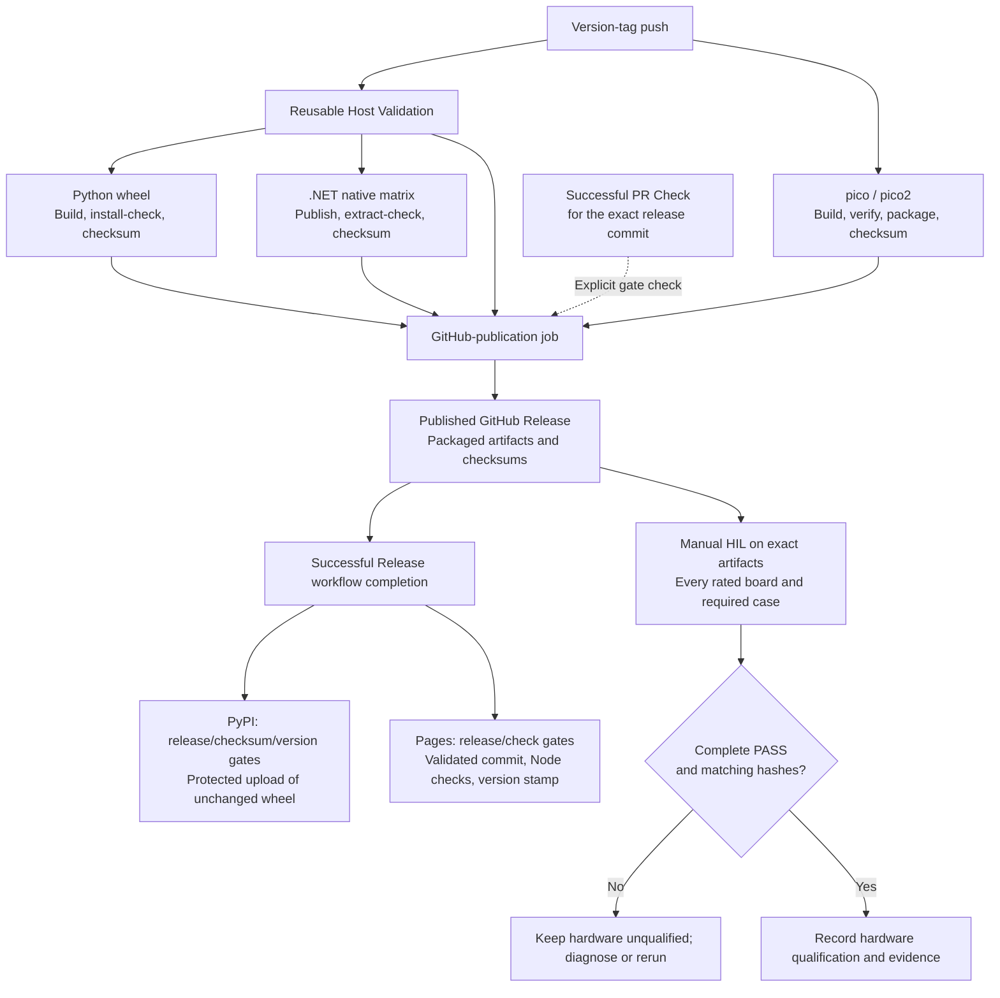

# GitHub Actions: Validation and Releases

This page maps the automated checks and how the release workflows depend on each other. The workflow files are the
source of truth for job names, matrices, and toolchain pins.

## Pull Requests And Main

[PR Check](../../.github/workflows/pr-check.yml) runs for pull requests and pushes to `main`.

The firmware matrix and host validation run in parallel. Repository pytest covers hardware-free HIL-tool tests and
packaging/protocol contracts, not physical UART behavior.

## Checks And Dependencies

[Host Validation](../../.github/workflows/host-validation.yml) is reused by both PR Check and Release.

| Check | Environment And Dependencies | What It Establishes |
| --- | --- | --- |
| Firmware matrix | Linux; Arm toolchain, pinned Pico SDK, CMake/Ninja, host C++ compiler, Python | Pico and Pico 2 compile/link and satisfy binary contracts plus target-specific static SRAM/flash budgets; real-build regulator policy is inspected, not physically measured |
| Firmware policy check | Python and the `test` dependency group | Minimal pytest environment for inspection of the actual SDK build artifacts |
| Host application matrix | Linux, macOS, Windows; Python 3.12, .NET 10 SDK, Python `dev` dependency group | .NET unit tests, repository Python tests, and installed/published host contracts; Windows and macOS also run native C tests |
| Linux host tools | Python 3.12, Python `dev` dependency group, native C toolchain, CMake/Ninja, cppcheck | Syntax, ASan/UBSan native tests, static analysis, and CLI smoke checks |
| Python minimum | Linux; Python 3.10 and Python `dev` dependency group | Repository Python checks on the minimum supported interpreter |
| Browser host | Linux; Node 22 | JavaScript syntax, WebHID tests, and the shared dashboard contract test under `host/web/tests` |
| Release Python wheel | Python build backend/plugin and wheel-declared runtime dependencies | Wheel version, clean installation outside the checkout, and bundled dashboard startup response |
| Release .NET archives | Native Linux/Windows/macOS runners and .NET SDK | Self-contained publishing for the configured runtime matrix, archive extraction, CLI startup, and embedded version |
| Physical HIL | Identified board, intended flashed artifact, and required fixture | UART payload integrity, health, timing/recovery behavior, and conditions absent from CI |

CI cannot establish board compatibility, physical timing, or overclock margins; that is what HIL is for.

## Release And Publication

[Release](../../.github/workflows/release.yml) runs on a version-tag push or as a manual preflight. Firmware packaging
starts alongside host validation; the Python and .NET packages wait for all host validation jobs. Only a tag push
publishes.

The exact-commit PR Check is checked by a gate script, not a `needs` dependency, and a tag push does not run it. PyPI
and Pages are triggered by `workflow_run` on Release completion. This is because a release event created with
`GITHUB_TOKEN` does not start other workflows. Gate rules and hardware qualification are described in
[releasing](../deployment/releasing.md), and channel operations in
[host app publishing](../deployment/host-app-publishing.md).

When you change a workflow's triggers, `needs`, tests, or dependency setup, update this map too.
