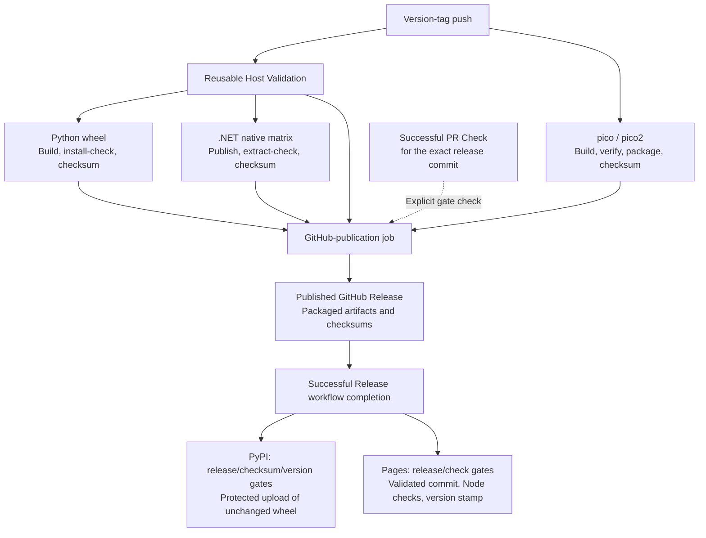

# GitHub Actions: Validation and Releases

PR Check and Release share host validation; Release adds packaging and publication gates. The workflow files are the
source of truth for job names, matrices, and toolchain pins.

## Pull Requests and Main

[PR Check](../../.github/workflows/pr-check.yml) runs for pull requests and pushes to `main`.

The firmware matrix and host validation run in parallel; both must pass for PR Check to succeed. Repository pytest
covers hardware-free HIL-tool tests and packaging/protocol contracts, not physical UART behavior.

## Validation Gates

[Host Validation](../../.github/workflows/host-validation.yml) is reused by both PR Check and Release.

| Gate | What it checks |
| --- | --- |
| Firmware builds | Pico and Pico 2 compile/link, pass binary contracts, and meet target-specific static SRAM/flash budgets |
| Firmware policy | The SDK build leaves regulator auto-adjust disabled, based on compile commands, defines, and linked artifacts |
| Host applications | Python and .NET tests, plus installed/published host contracts |
| Linux host tools | Native C sanitizers, syntax checks, static analysis, and CLI smoke checks |
| Minimum Python | Repository Python checks on the minimum supported interpreter |
| Browser | JavaScript syntax, WebHID tests, and the shared dashboard contract test under `host/web/tests` |
| Python wheel | Version, clean installation outside the checkout, and bundled dashboard startup response |
| .NET archives | Self-contained publish, archive extraction, CLI startup, and embedded version |

CI has no board. Run [physical HIL](../tests/README.md) separately for UART payload integrity, health, timing, and
recovery behavior.

## Release and Publication

[Release](../../.github/workflows/release.yml) runs on a version-tag push or as a manual preflight. Firmware packaging
starts alongside host validation; the Python and .NET packages wait for all host validation jobs. Only a tag push
publishes.

PyPI and Pages run from `workflow_run` after Release completes. A release event created with `GITHUB_TOKEN` does not
start other workflows. See [releasing](../deployment/releasing.md) for publication gates and hardware qualification,
and [host app publishing](../deployment/host-app-publishing.md) for channel operations.

When workflows change their triggers, gate dependencies, or what the checks establish, update this map too.

## Manual Hardware Qualification

CI publishes candidate artifacts. Qualify those exact artifacts manually using the
[release HIL gates](../deployment/releasing.md#release-hil-gates).
