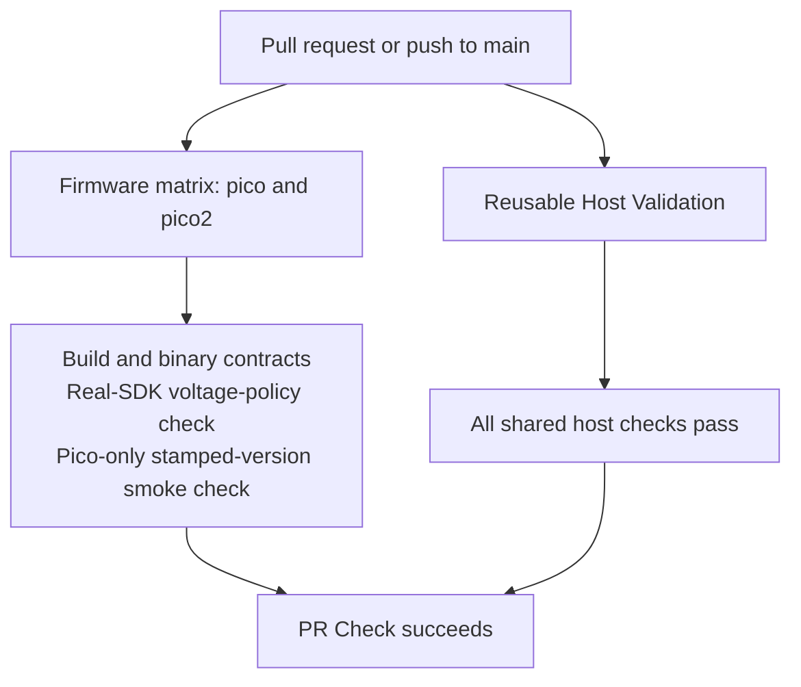
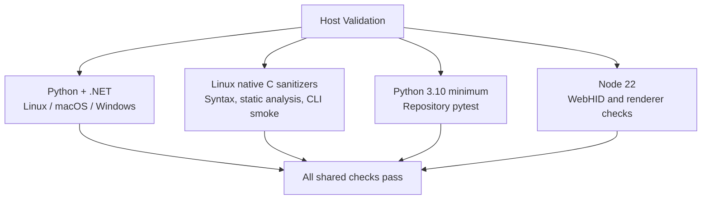
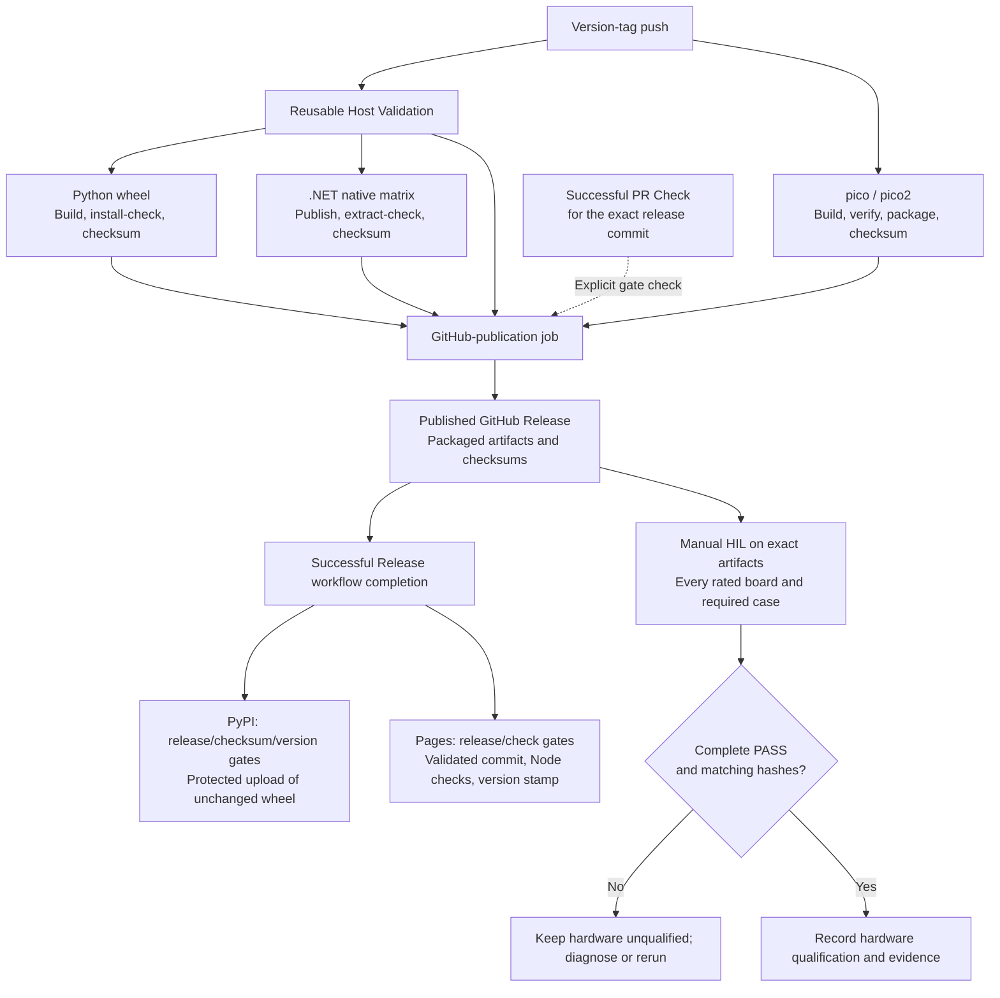

# GitHub Actions: Validation and Releases

This guide maps the current automated checks and release dependencies. The linked workflows are authoritative for job
names, matrices, and toolchain pins. Use the [test index](../tests/README.md) for local commands and test levels,
and [Releasing PicoUart](../deployment/releasing.md) for promotion and publishing procedures.

## Pull Requests And Main

[PR Check](../../.github/workflows/pr-check.yml) runs for pull requests and pushes to `main`. Its firmware matrix and
reusable host validation run in parallel; firmware builds do not wait for host tests.

Within a job, steps run in order. The four Host Validation branches are independent jobs, and each OS/board matrix leg
runs independently. Success boxes summarize completion; they are not additional workflow jobs. Any required failure
prevents that workflow from succeeding. Repository branch-protection settings separately control merge requirements.

Repository pytest includes hardware-free HIL-tool tests and packaging/protocol contracts, not physical UART tests.
SDK-dependent .NET integration checks can skip when no SDK executable is available; the three-OS application matrix
explicitly installs .NET and also runs its unit suite.

## Checks And Dependencies

[Host Validation](../../.github/workflows/host-validation.yml) is reused by both PR Check and Release.

The application-matrix job runs .NET unit tests before repository pytest; Windows runs native C tests afterward.
The Pico-only stamped-version check is a conditional step inside the PR firmware matrix, not another job.

| Check | Environment And Dependencies | What It Establishes |
| --- | --- | --- |
| Firmware matrix | Linux; Arm toolchain, pinned Pico SDK, CMake/Ninja, host C++ compiler, Python | Both board targets compile/link and satisfy binary USB/version contracts; real-build regulator policy is inspected, not physically measured |
| Firmware policy check | Python and `requirements-voltage-lock.txt` | Minimal pytest environment for inspection of the actual SDK build artifacts |
| Host application matrix | Linux, macOS, Windows; Python 3.12, .NET 10 SDK, `requirements-lock.txt` | .NET unit tests, repository Python tests, and installed/published host contracts; Windows also runs native C tests |
| Linux host tools | Python 3.12, development lock, native C toolchain, CMake/Ninja, cppcheck | Syntax, ASan/UBSan native tests, static analysis, and CLI smoke checks |
| Python minimum | Linux; Python 3.10 and development lock | Repository Python checks on the minimum supported interpreter |
| Browser host | Linux; Node 22 | JavaScript syntax and hardware-free WebHID/shared-renderer contracts |
| Release Python wheel | Python build backend/plugin and `requirements-runtime-lock.txt` | Wheel version, clean installation outside the checkout, and bundled dashboard startup response |
| Release .NET archives | Native Linux/Windows/macOS runners and .NET SDK | Self-contained publishing for the configured runtime matrix, archive extraction, CLI startup, and embedded version |
| Physical HIL | Identified board, intended flashed artifact, and required fixture | UART payload integrity, health, timing/recovery behavior, and conditions absent from CI |

Locks contain reviewed versions and hashes; the
[host development guide](host-tools.md#python-dependencies-and-locking)
owns their declarations and generation. Version stamping and host transport checks do not establish board compatibility
or physical overclock/voltage margins. See [HIL scope](../tests/hil-fixture-test-plan.md) for the evidence limits.

## Release And Publication

[Release](../../.github/workflows/release.yml) runs on a version-tag push or manual preflight. Firmware packaging starts
alongside Host Validation. Python and .NET packaging wait for **all** Host Validation jobs, not for firmware packaging.
Only a tag push enters the automatic GitHub-publication job.

The exact-commit PR Check is a **separate workflow requirement**, not a Release `needs` job. A tag push does not itself
trigger PR Check. A successful PR run for a different merge commit does not satisfy this gate; confirm a successful
matching run, commonly from the push to `main`, before releasing that commit.

CI publishes tested tags but does not perform physical HIL or automatically qualify hardware. Artifact hashes identify
the tested image; record the board's active clock profile and boot fallback too. A local rebuild, a partial run, or a
ceiling-search aggregate `PASS` with failed rows cannot replace required exact-artifact evidence.

After successful Release completion, PyPI and Pages independently recheck the exact-commit PR Check and matching
tag-push run. They reject a tag moved away from the triggering commit. PyPI reuses the released wheel; Pages runs its
own Node checks before deployment. Repository environment approvals still apply. The `workflow_run` trigger avoids
depending on a release event emitted by `GITHUB_TOKEN`, which GitHub does not forward to downstream workflows.

## Manual Modes And Failures

| Mode Or Failure | Consequence |
| --- | --- |
| Manual Release preflight | Builds firmware and host artifacts with the entered version label, but creates no release or public upload |
| Independent .NET packaging test | Native archive checks produce marked workflow artifacts; no release attachment or publication |
| Explicit Python test publication | Scoped package tests and installed-wheel checks, then an approved public development upload to production PyPI |
| Explicit Pages test publication | Scoped Node checks, then a marked deployment replacing the live site; not a private preview |
| Required automated check fails | No successful normal gate; fix or rerun before continuing |
| HIL fails, is partial, or lacks matching artifacts | Keep the published artifacts hardware-unqualified/lab-only; do not claim a HIL pass |
| PyPI or Pages fails after GitHub publication | Diagnose/retry that channel; GitHub publication and the other channel are not automatically rolled back |

Manual test modes are intentional exceptions, not equivalent substitutes for the normal release graph. The
[publication gates](../deployment/releasing.md#publication-gates) own fail-closed run selection and test-version rules;
the [publishing runbook](../deployment/host-app-publishing.md) owns setup, retries, and rollback. Changing a workflow's
triggers, `needs`, tests, or dependency setup should include reviewing this map.