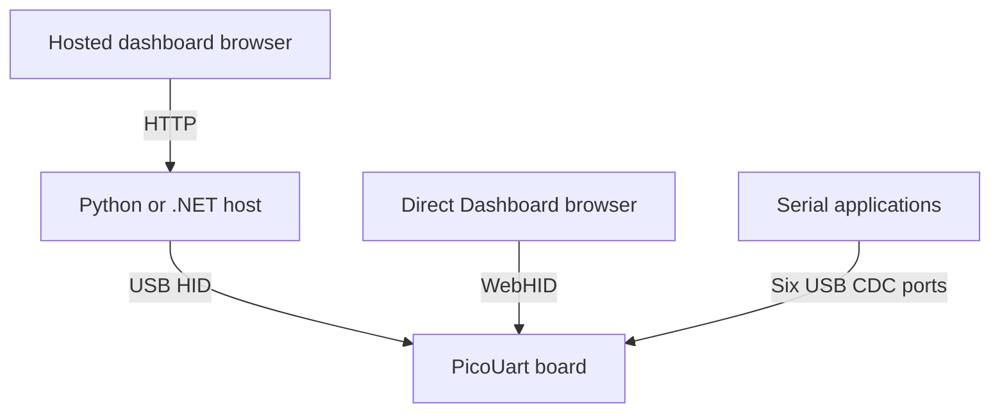

# Host Tools Development

This guide covers development and tests for the Python package and .NET host. The browser applications have a separate
[dashboard development guide](dashboard-development.md); user setup is in the [Python](../../host/python/README.md),
[.NET](../../host/dotnet/README.md), and [Direct Dashboard](../../host/direct/README.md) guides.

Run commands from the repository root. None of the setup or test steps here need a board.

## Architecture

The host tools use HID for board status and controls. UART data and line coding stay on the six CDC ports used by
serial applications.



The [HID reference](../design/usb/hid-report-reference.md) defines the wire format. Hosts validate and decode reports,
then expose typed snapshots and explicit errors. Feature reads do not advance traffic totals or rate baselines. A
timed-out control may still finish, so hosts verify its result and never retry reboot or save automatically. Routine
HTTP request logs are off by default.

## Prerequisites

Install only what you need:

- Python 3.10+ and pip 25.1+ for Python and cross-backend checks
- .NET 10 SDK for .NET development
- Node 22+ for dashboard tests
- Desktop Chrome or Edge for WebHID
- Git with full tag history; versions come from tags

## Python Environment Setup

The [host launchers](../../tools/README.md) need no setup. For development, create a venv with the `dev` dependency
group and install the package editable:

```sh
python3 -m venv host/python/.venv
host/python/.venv/bin/python -m pip install --group host/python/pyproject.toml:dev
host/python/.venv/bin/python -m pip install --no-build-isolation -e host/python
```

On native Windows, use `python` and `host/python/.venv/Scripts/python.exe`. Re-run both installs when dependencies
change. If hidapi has no wheel for your platform, pip builds it from source and needs native build prerequisites.

On Linux, if hidapi is built on libusb, Python opens the board's hidraw node instead of detaching the kernel HID driver.
If that node exists but cannot be opened, Python reports a permission error rather than falling back to libusb.

## Python Development

### Tests and Checks

```sh
host/python/.venv/bin/python -m pytest -c pyproject.toml
(cd host/python && .venv/bin/python -m ruff check src tests && .venv/bin/python -m mypy)
```

For just the package, use `-c host/python/pyproject.toml host/python/tests`; add
`--cov=pico_uart --cov-report=term-missing` for coverage. Mypy enforces `disallow_untyped_defs`.

Runtime dependencies belong in `project.dependencies`; test and development tools belong in the `test` and `dev`
groups in [pyproject.toml](../../host/python/pyproject.toml). The contract test checks these declarations and that no
lock files have been added.

### Python Client API

`PicoUartHid` is the supported entry point. It owns one HID connection; use it as a context manager. Pass
`serial_number="ABC123"` to select a board. Device errors raise `OSError` or `RuntimeError`.

| Method | Returns |
| --- | --- |
| `read_status(timeout_ms=250)` | Latest six-channel Input snapshot, or `None` on timeout |
| `read_identity()` / `read_board_status()` | Identity and capabilities; board status also includes temperature |
| `read_telemetry()` | Live board telemetry |
| `read_configuration()` | Boot-time pins, capacities, stored profile, and reset cause |
| `read_channel(index)` | On-demand channel Feature snapshot |
| `read_channel_diagnostic(index)` | RX fault history, configuration error, sample age, and buffer peaks |
| `read_channel_diagnostics()` | Diagnostics for all six channels |

`read_status()` updates only the channel whose Input report arrived; it does not wait for all six. Public names are
listed in `pico_uart.__all__`.

After opening and configuring CDC TTYs and asserting DTR, call
`board.wait_channels_ready({0: 115200}, timeout_s=3.0)` before transmitting. It raises `OSError` on a current
failure and `TimeoutError` on expiry. Select the HID board using the same USB serial number as the TTY.

`toggle_led()`, `reset_board()`, and `save_configuration(profile, unsafe_overclock=False)` implement board controls.
Saving a profile reboots the board; follow the
[HID save rules](../design/usb/hid-report-reference.md#save-and-reboot-safety).

### Cross-Backend Test Behavior

Python `status --json` and .NET `status` print the same `{"channels": [...]}` shape with six entries. A channel without
an Input report yet has `sequence: null` and `state: "unknown"`. Traffic gaps set `traffic_incomplete`.

Python `monitor` fails if it receives no reports; .NET `monitor` can succeed with none. Both drop reports that
complete at or after the deadline. Dropped-byte counts and peaks are cumulative since boot.

### Python Distribution

Building locally does not publish. Release channels and gates are described in
[Host App Distribution and Publishing](../deployment/host-app-publishing.md).

```sh
mkdir -p host/python/src/pico_uart/dashboard/assets
cp -R host/web/src/. host/python/src/pico_uart/dashboard/assets/
uv build --wheel --directory host/python
```

`hatch-vcs` derives versions from Git tags. Without Git metadata, the version is `0.0.0.dev0`; set
`SETUPTOOLS_SCM_PRETEND_VERSION` to override it. Staged dashboard assets are included in the wheel.

## .NET Development

`host/dotnet/PicoUart.sln` contains the app and xUnit tests.

```sh
dotnet run --project host/dotnet/PicoUart -- web --port 5001
dotnet test host/dotnet/PicoUart.sln --filter "Category=Unit"
dotnet format host/dotnet/PicoUart.sln --verify-no-changes --no-restore
host/python/.venv/bin/python -m pytest tests/tooling/test_dotnet_host.py
```

The unit tests use scripted HID streams and share [Input-accounting cases](../../tests/contracts/host-input-cases.json)
with Python. The cross-backend check publishes the app and verifies the shared frontend and HTTP contract. It is
skipped if `dotnet` is not on `PATH`; `DOTNET_EXE` overrides the executable.

For a local framework-dependent publish:

```sh
dotnet publish host/dotnet/PicoUart -c Release --self-contained false -o build/host-dotnet
dotnet build/host-dotnet/PicoUart.dll web --port 5001
```

For a self-contained publish, add `--self-contained true -r linux-x64` (or another RID). Ship the whole output
directory, including `web/`. Use `-p:MinVerVersionOverride=1.2.3` to set the version.
