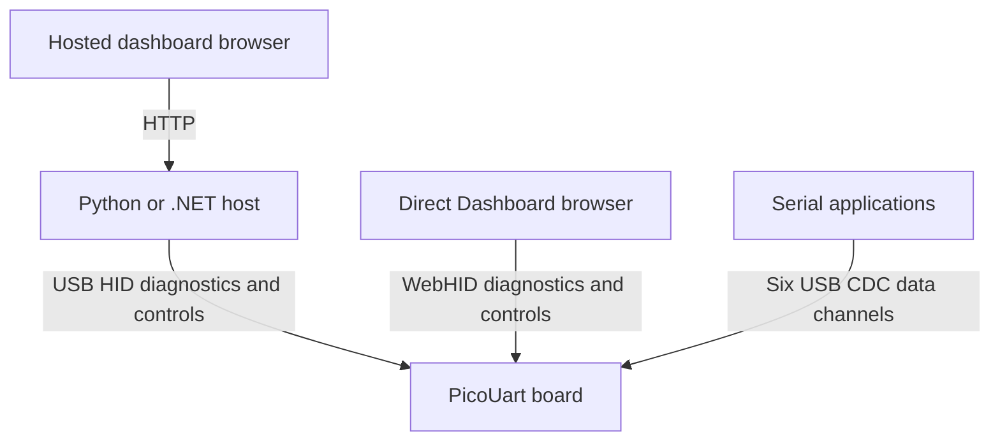
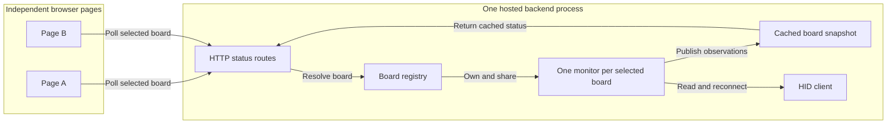

# Host Tools Development

This guide is for working on the host applications: the Python package, the .NET host, the shared hosted dashboard,
and the browser-only Direct Dashboard. For installing and using them, see the [Python](../../host/python/README.md),
[.NET](../../host/dotnet/README.md), and [Direct Dashboard](../../host/direct/README.md) guides.

None of the setup, build, or test steps here need a board. Run commands from the repository root.

## Architecture

The host tools talk to the board only through its HID interface. UART data stays on the six CDC ports, which belong to
the user's serial applications. No dashboard proxies UART traffic or changes line coding.

<!-- mermaid-checked: quoted labels, valid flowchart syntax, unique node IDs -->


The hosted dashboards (Python and .NET) serve one shared frontend from `host/web/src`. The board must be plugged into
the server's computer. The Direct Dashboard is a separate static app that uses WebHID from the browser's own computer.
The two kinds of dashboard are alternatives; they do not cooperate.

| Layer | Responsibility |
| --- | --- |
| Transport | Find the right HID interface and handle platform device access. |
| Decoding | Validate each report and turn it into typed data, with no I/O. |
| HID client | Own one connection, serialize operations, cache boot metadata, and verify control results. |
| Board monitor | Poll and reconnect in the background, keeping a coherent cached snapshot per board. |
| HTTP app | Resolve the board, check session and CSRF, and return snapshots or explicit errors. |
| Frontend | Render data, keep page-local selection and rate windows, and show control outcomes honestly. |

The wire format and field meanings are defined in the [HID report reference](../design/usb/hid-report-reference.md).
This guide covers how the hosts use it. Three rules run through every layer:

- **Partial data is normal.** Identity, telemetry, configuration, diagnostics, and control results can each fail on
  their own. Keep the valid parts and mark the rest unavailable; never show a missing value as zero.
- **Only Input reports count as traffic.** Feature reads give current state, but they never advance traffic totals or
  rate baselines.
- **Controls are verified, never blindly retried.** A native transfer that timed out may still complete, so cleanup
  waits for it. A timeout or disconnect leaves the outcome unknown, and the hosts never retry a reboot or save on their
  own.

## Prerequisites

Install only what the part you are changing needs:

- Python 3.10+ and pip 25.1+, for the Python host and the cross-backend checks
- .NET 10 SDK, for the .NET host
- Node 22+, for the dashboard unit tests
- desktop Chrome or Edge, for WebHID
- Git with full tag history, because versions are derived from tags

## Python Environment Setup

The [host launchers](../../tools/README.md) need no setup. For development and tests, create a venv with the `dev`
dependency group and an editable install:

```sh
python3 -m venv host/python/.venv
host/python/.venv/bin/python -m pip install --group host/python/pyproject.toml:dev
host/python/.venv/bin/python -m pip install --no-build-isolation -e host/python
```

On native Windows, use `python` and `host/python/.venv/Scripts/python.exe`. Re-run both installs whenever the
dependencies change. If hidapi has no wheel for your platform, pip builds it from source, which needs the native build
prerequisites.

On Linux, Python opens the hidraw node even when hidapi uses libusb, so it never detaches the kernel HID driver that
.NET and WebHID rely on. A permission error is reported rather than retried through libusb.

## Python Development

### Tests and Checks

```sh
host/python/.venv/bin/python -m pytest -c host/python/pyproject.toml host/python/tests   # package tests
host/python/.venv/bin/python -m pytest -c pyproject.toml                                  # all repository tests
host/python/.venv/bin/python -m pytest -c host/python/pyproject.toml host/python/tests \
  --cov=pico_uart --cov-report=term-missing
(cd host/python && .venv/bin/python -m ruff check src tests && .venv/bin/python -m mypy)
```

Mypy enforces `disallow_untyped_defs`.

Dependencies are declared in [pyproject.toml](../../host/python/pyproject.toml): the runtime goes in
`project.dependencies`, and the `test` and `dev` groups hold the rest. Direct dependencies are version-pinned, but the
environments are not hash-locked. A [contract test](../../tests/contracts/test_firmware_contract.py) checks the
declarations and that no lock files have crept in.

### Python Client API

`PicoUartHid` is the supported entry point. It owns one HID connection; use it as a context manager. Pass
`serial_number="ABC123"` to pick a board. Device errors raise `OSError` or `RuntimeError`.

| Method | Returns |
| --- | --- |
| `read_status(timeout_ms=250)` | Latest six-channel Input snapshot, or `None` on timeout |
| `read_identity()` / `read_board_status()` | Static identity and capabilities; board status also includes temperature |
| `read_telemetry()` | Live board telemetry |
| `read_configuration()` | Cached boot-time pins, capacities, stored profile, and reset cause |
| `read_channel(index)` | An on-demand channel Feature snapshot, separate from Input traffic totals |
| `read_channel_diagnostic(index)` | RX fault history, last configuration-error reason, measurement age, and buffer peaks |
| `read_channel_diagnostics()` | Diagnostics for all six channels |

Things to know:

- `read_status()` updates only the channel whose Input report arrived; it does not wait for all six.
- `timeout_ms=0` becomes a 1 ms poll, because hidapi treats zero as wait forever.
- `close()` returns false while an in-flight transfer holds the native handle; `wait_closed(timeout_s=...)` waits.
  Module-level helpers such as `read_board_status` and `reset_board` share the device's in-flight state, so after one
  times out, later calls fail until the transfer returns.

The names in `pico_uart.__all__` are the supported API; module paths and private helpers are not.

**Readiness.** After opening and configuring the CDC TTYs and asserting DTR, call
`board.wait_channels_ready({0: 115200, 2: 115200}, timeout_s=3.0)` before transmitting. It waits until those channels
are open and ready, with 8N1 within 3% of the requested baud and nothing pending. It raises `OSError` on a current
failure and `TimeoutError` on expiry; historical faults do not count. Select the HID board using the same USB serial
number as the TTYs.

**Controls.** `toggle_led()` and `reset_board()` back the CLI's `toggle-led` and `reset` commands.
`save_configuration(profile, unsafe_overclock=False)` saves a clock profile and reboots, and
`read_configuration_save()` reads the result. Both follow the
[HID save rules](../design/usb/hid-report-reference.md#save-and-reboot-safety). An LED toggle counts as successful
once the firmware confirms it, even if the telemetry refresh afterwards fails.

### Python Test Automation

Python `status --json` and .NET `status` print the same object, `{"channels": [...]}`, with six entries and sorted
keys. A channel with no Input yet is a placeholder (`sequence` is `null`, `state` is `"unknown"`). A channel's first
Input seeds its totals, and `traffic_incomplete` stays set once an unusable interval or a gap has been seen.

`status` retries until `--timeout` (default 2 s) and fails without a valid report. Python `monitor` fails if it
receives no reports; .NET `monitor` can succeed with none. Both drop reports that complete at or after the deadline.
Dropped-byte counts and peaks are cumulative since boot, so compare before and after a run. A zero exit code is not a
health check, so test runners should inspect the reported states and counters.

```sh
pico-uart overruns > overruns-before.txt
pico-uart monitor --duration 60 > uart-traffic.log
pico-uart overruns > overruns-after.txt
```

### Python Distribution

Building locally does not publish anything. Release channels and gates are described in
[Host App Distribution and Publishing](../deployment/host-app-publishing.md).

```sh
mkdir -p host/python/src/pico_uart/dashboard/assets
cp -R host/web/src/. host/python/src/pico_uart/dashboard/assets/
uv build --wheel --directory host/python
```

`hatch-vcs` derives the version from Git tags (`v1.2.3` gives `1.2.3`, and later commits give dev versions). Without
Git metadata the version is `0.0.0.dev0`, which the dashboard shows as `0.0.0-debug`. Set
`SETUPTOOLS_SCM_PRETEND_VERSION` to force a version. Staged dashboard assets are included in the wheel even when Git
does not track them. `host/python/README.md` is the PyPI page, so keep it user-focused; contributor details belong here.

## .NET Development

`host/dotnet/PicoUart.sln` contains the app and its xUnit tests.

```sh
dotnet run --project host/dotnet/PicoUart -- status
dotnet run --project host/dotnet/PicoUart -- web --port 5001
dotnet build host/dotnet/PicoUart.sln
dotnet test host/dotnet/PicoUart.sln --filter "Category=Unit"
dotnet format host/dotnet/PicoUart.sln --verify-no-changes --no-restore
```

`tools/host/run-dotnet.sh` starts the dashboard on Linux, macOS, and WSL. The unit tests use scripted HID streams, and
they share [Input-accounting cases](../../tests/contracts/host-input-cases.json) with Python. The cross-backend check
publishes the app and verifies the shared frontend and HTTP contract. It is skipped if `dotnet` is not on `PATH`;
`DOTNET_EXE` overrides the executable.

```sh
host/python/.venv/bin/python -m pytest tests/tooling/test_dotnet_host.py
```

Design notes:

- The HID client supports both `IDisposable` and `IAsyncDisposable`; async disposal also waits for deferred native
  cleanup, and the device cannot be reopened until that finishes.
- Board monitors run as background services, so HTTP requests never read HID directly. The control queue wait is capped
  at five seconds, and once a SET has started, cancellation no longer stops result verification.
- Diagnostics refresh is all-or-nothing: errors return 503 (I/O) or 504 (timeout) and the last good data stays visible
  with `diagnostics_error` set. A stale channel reports `state: unknown` with `null` live fields.

**Local publishing.** For a framework-dependent build:

```sh
dotnet publish host/dotnet/PicoUart -c Release --self-contained false -o build/host-dotnet
dotnet build/host-dotnet/PicoUart.dll web --port 5001
```

For a self-contained build, use `--self-contained true -r linux-x64` (or another RID). Ship the whole output
directory, including `web/`. `-p:MinVerVersionOverride=1.2.3` sets the version.

## Hosted Dashboard

### Frontend

Python and .NET serve the same frontend from `host/web/src`, written as native ES modules with no bundler. Keep it
backend-neutral; do not create a second frontend. If you change a module's cache-busting version, update every importer
and the HTML entry to match. The Python server sets correct MIME types for JS and CSS itself, so `nosniff` does not
break module loading.

The top bar shows the backend name and **App v**, the host version, not the firmware version. Python reports
`pico_uart.__version__` (from `hatch-vcs`), and .NET reports its assembly informational version (from MinVer).
`PICO_UART_HOST_VERSION` overrides the displayed value only. Routine HTTP request logs are off by default.

```sh
node --test host/web/tests/*.test.mjs host/direct/tests/*.test.mjs
```

### Board Selection and Shared Monitoring

- The **Board** list shows boards attached to the server's computer. It is scanned at startup and on **Rescan** only.
  `--serial` or `--device-path` sets the preferred initial board.
- Selection belongs to each page, so different tabs can watch different boards. Switching clears the old board's
  display and rate history. An unplugged board shows as **not found**; the page never switches to another board on its
  own.
- Boards are tracked by USB serial. A board without a serial is tracked by OS path, which cannot tell it apart from a
  replacement device on the same path.
- The server starts one HID reader per selected board and shares its snapshot with every viewer. Viewers never consume
  Input reports themselves. **Run only one host process per physical board.**
- The page polls at the backend's `refresh_interval_ms` hint. That is the latest valid Input `interval_ms`, clamped to
  500-1000 ms, and it starts at 500 ms.

<!-- mermaid-checked: quoted labels, valid flowchart syntax, closed subgraphs, unique node IDs -->


Readers keep running with no viewers, retry disconnected boards, and are removed once repeated scans stop finding the
board. On shutdown, or when a board is replaced, the old reader's native cleanup must finish before a new reader opens.
Until then, requests get a retryable error instead of blocking, and results from the old session are discarded.

### HTTP API

The servers listen on loopback only. Session cookies are named per backend and port
(`PicoUart.Python.Session.<port>`, `PicoUart.DotNet.Session.<port>`), and every write requires the session's CSRF
header.

| Endpoint | Purpose |
| --- | --- |
| `GET /api/boards` | `boards` (`id`, `product_name`, `serial_number`, `device_path`) and `default_board_id`; .NET adds per-device `discovery_errors`. |
| `GET /api/status?board=ID` | Cached board snapshot; without `board`, an empty six-channel snapshot. |
| `GET /api/diagnostics?board=ID` | Refreshes `channel_diagnostics` (reports 30-35). |
| `POST /api/actions/{toggle-led,reset}?board=ID` | Board actions. |
| `POST /api/configuration?board=ID` | Save a clock profile and reboot. |

Status snapshots contain:

- `identity`, `runtime`, `configuration`, and `led`, each with its own `*_error`, so one failed read never hides the
  rest. Identity and configuration are read once per connection; runtime is polled. `toggle-led` sends the explicit
  opposite of the observed LED state, so an unknown state disables it.
- `channels` with per-channel lifecycle, applied framing, `sequence`, `updated_at`, `totals`, `traffic` (per-Input byte
  increments, not rates), `traffic_gaps`, `traffic_incomplete`, and `observed_interval_ms`.
- `overflow_counts`, taken from diagnostics and `null` when unavailable, and the `configuration_save*` fields.

Control error responses carry `outcome_unconfirmed`, so the frontend never guesses retry safety from error text.
Python returns HTTP 409 with a fixed public message for confirmed firmware rejections; the details go to the server log.

### Persistent Configuration

All three dashboards show the stored boot profile under **Hardware & boot**. A non-default profile needs the
unsafe-overclock checkbox before **Save & Reboot** is enabled. Editing writes nothing to the board, and telemetry
refreshes never overwrite an unsaved edit.

`POST /api/configuration` takes exactly `{"profile": 0-4, "unsafe_overclock": bool}` in a body of at most 1 KiB, and
succeeds only after the firmware reports Completed. After a timeout or disconnect, both backends keep a
`configuration_save_unconfirmed` warning in the shared snapshot, across reconnects and page reloads. Only a later
confirmed save clears it, because reading report 20 cannot show which request produced the result. The rules behind
this are in the [HID reference](../design/usb/hid-report-reference.md#save-and-reboot-safety).

### Channel Diagnostics and Traffic Presentation

- Applied baud and framing come from the channel snapshots, and GPIOs from report 2, never from a hard-coded map or a
  CDC request that may have been rejected.
- Rates are shown in KB/s (1000 bytes) over windows of at least one second, computed from `totals` and
  `observed_interval_ms` rather than browser arrival times, following the
  [HID reference](../design/usb/hid-report-reference.md#sequence-interval-and-rates). An unusable window shows `--`,
  and three seconds without an Input marks the channel stale.
- Lifecycle badges are Closed, Starting, Ready, Configuring, Error, and host-side Unknown. Fault history and the last
  configuration error appear beside the badge and cannot be cleared.
- The header shows `Telemetry stale` with the sample age once data goes stale, and `Waiting for telemetry` before the
  first sample.

## Direct Dashboard Development

The Direct Dashboard is a standalone WebHID app in `host/direct/`, with its own assets and renderer and no server-side
code.

```sh
tools/host/run-direct.sh                                # serves http://127.0.0.1:8000/ (--port N)
python tools/host/direct_site.py serve --port 8000      # without a POSIX shell
```

The launcher serves a staged copy with a version derived from Git tags. Do not open the HTML straight from disk:
WebHID needs HTTPS or localhost.

```sh
node --check host/direct/src/js/view.mjs
node --check host/direct/src/js/app.mjs
node --test host/direct/tests/*.test.mjs
python -m pip install playwright==1.63.0
python -m playwright install --with-deps chromium
python host/direct/tests/browser_smoke.py               # simulated-device browser smoke test, as in CI
```

The Node tests cover the report framing, the version checks, and the presentation rules shared with the hosted
renderer. They do not prove that real browser and OS USB access works. Deployment to Pages is described in
[Host App Distribution and Publishing](../deployment/host-app-publishing.md#direct-dashboard-pages).
