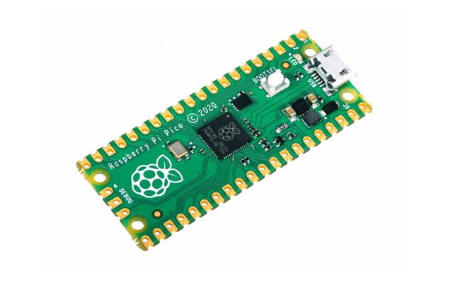

# Hardware Setup

How to wire UART devices to a PicoUart board and find its serial ports. The pin assignments come from
[uart_config.c](../firmware/src/config/uart_config.c).

## Supported Boards

| Board | MCU | Firmware image |
| --- | --- | --- |
| Raspberry Pi Pico | RP2040 | `pico` |
| Raspberry Pi Pico 2 | RP2350 | `pico2` |




[Wireless boards](#wireless-boards) and the [PicoUART6 carrier](#picouart6-carrier-compatibility) are covered below.

## Installing Firmware

For first setup or an update, download the matching `.uf2` from
[GitHub Releases](https://github.com/djwinter29-oss/PicoUart/releases): `pico` for Pico or `pico2` for Pico 2. Hold
**BOOTSEL** while connecting the USB cable, then copy the file to the `RPI-RP2` or `RP2350` drive. The board reboots
when the copy finishes. Confirm its firmware version over HID before resuming UART traffic.

For release qualification, verify the artifact checksum and follow the
[release flashing procedure](deployment/releasing.md#flashing-release-artifacts).

## Port Map

The host sees six USB CDC ACM ports. Each CDC port maps to one target-side UART:

| USB CDC | UART  | Backend        | TX   | RX   | Optional RTS | Optional CTS |
| ------- | ----- | -------------- | ---- | ---- | ------------ | ------------ |
| CDC0    | UART0 | Hardware UART0 | GP0  | GP1  | GP3          | GP2          |
| CDC1    | UART1 | Hardware UART1 | GP4  | GP5  | GP7          | GP6          |
| CDC2    | UART2 | PIO UART       | GP8  | GP9  | GP10         | GP11         |
| CDC3    | UART3 | PIO UART       | GP12 | GP13 | GP14         | GP15         |
| CDC4    | UART4 | PIO UART       | GP16 | GP17 | GP18         | GP19         |
| CDC5    | UART5 | PIO UART       | GP20 | GP21 | GP22         | GP26         |

Normal wiring needs only TX, RX, and ground. The RTS/CTS pins are reserved, but flow control is off in the default
firmware; enabling it is a per-port build setting listed under
[firmware configuration](../firmware/build-and-config.md#configuration).

## Find the Serial Ports

Host port numbers such as `/dev/ttyACM*` or `COMx` depend on enumeration order, so identify each CDC port by its USB
interface instead. CDCn uses USB interface number 2×n and the interface name below, from the
[USB descriptors](../firmware/src/usb/usb_descriptors.c):

| USB CDC | Interface number | Linux `by-id` suffix | Interface name |
| ------- | ---------------- | -------------------- | -------------- |
| CDC0    | 0                | `-if00`              | `CDC0 HW`      |
| CDC1    | 2                | `-if02`              | `CDC1 HW`      |
| CDC2    | 4                | `-if04`              | `CDC2 PIO 8N1` |
| CDC3    | 6                | `-if06`              | `CDC3 PIO 8N1` |
| CDC4    | 8                | `-if08`              | `CDC4 PIO 8N1` |
| CDC5    | 10               | `-if0a`              | `CDC5 PIO 8N1` |

On Linux, use the stable paths from `ls -l /dev/serial/by-id/`; the suffix is the hexadecimal interface number. On
other systems, match the interface number or name shown by the OS device tools. With several boards attached, the
board's unique USB serial number in the device name distinguishes them.

Example observed Linux entries (board serial redacted; `/dev/ttyACM*` assignments vary):

```text
usb-PicoUart_PicoUart_<board-serial>-if00 -> ../../ttyACM2
usb-PicoUart_PicoUart_<board-serial>-if02 -> ../../ttyACM3
usb-PicoUart_PicoUart_<board-serial>-if04 -> ../../ttyACM4
usb-PicoUart_PicoUart_<board-serial>-if06 -> ../../ttyACM5
usb-PicoUart_PicoUart_<board-serial>-if08 -> ../../ttyACM6
usb-PicoUart_PicoUart_<board-serial>-if0a -> ../../ttyACM7
```

## PicoUART6 Carrier Compatibility

With flow control disabled, PicoUart's six UART TX/RX pairs match the published pinout of
[8086net/pico-sexa-uart-bridge](https://github.com/8086net/pico-sexa-uart-bridge). This provides UART TX/RX pin
compatibility with the PicoUART6 carrier sold on [Lectronz](https://lectronz.com/products/picouart6) and
[The Pi Hut](https://thepihut.com/products/picouart6). The carrier's extra features are not supported:

- The carrier's UART activity, I2C activity, and GPIO-controlled power LEDs are not driven by PicoUart. The Pico's own
  identification LED is separate and remains available on non-wireless Pico/Pico 2 boards.
- The STEMMA QT/Qwiic connector has no firmware I2C support: PicoUart does not expose a USB-to-I2C interface and is not
  compatible with the original firmware's `i2c-tiny-usb` functionality.
- Keep RTS/CTS disabled on this carrier. PicoUart's optional flow-control assignments overlap the carrier's LED and I2C
  wiring; enabling them requires a separately reviewed pin map and hardware setup.

## Wiring Rules

- Connect PicoUart TX to the peer RX.
- Connect PicoUart RX to the peer TX.
- Share ground between PicoUart and every UART peer.
- Connect RTS to the peer's CTS, and CTS to the peer's RTS, only when flow control is enabled and tested.
- Use 3.3 V UART logic. Never connect 5 V or RS-232 levels directly to RP2040 or RP2350 GPIOs.

For the fixed loopback wiring used in hardware tests, see [HIL fixture setup](tests/hil-fixture-setup.md).

## GPIO Availability Notes

- This allocation targets Pico-class boards that expose GP0-GP22 and GP26-GP28 on headers.
- GP23 and GP24 are not used because they are not generally available on standard Pico headers.
- GP25 is reserved for the selected board's default LED when `PICO_DEFAULT_LED_PIN` is defined.
- GP26 is used as UART5 CTS when PIO flow control is enabled. In that configuration it is not available as an ADC input.
- GP27 and GP28 remain free for future use.

## Wireless Boards

Pico W and Pico 2 W expose the same UART pins listed above. Build specifically for `pico_w` or `pico2_w` using the
[firmware build guide](../firmware/build-and-config.md#build). The firmware operates as a USB/UART bridge only;
Wi-Fi and Bluetooth are not initialized or used.

The wireless boards' onboard LED is connected through the wireless chip rather than a direct MCU GPIO, so HID LED
identification is unavailable in these builds. Do not use the non-wireless `pico` or `pico2` image: it treats GPIO25
as an LED output, but that pin is the wireless chip-select on W boards.

The release build and HIL matrix covers Pico and Pico 2 only. Wireless variants have no physical UART, throughput, or
clock-stability qualification yet.

## Power

Do not power six external targets from the Pico unless the supply is rated for their combined current. For a carrier
with target-power output, check its documented current limit and protection before connecting devices.

## Photo Credits

Pico photo by Misael Reséndiz
([source](https://commons.wikimedia.org/wiki/File:Raspberry_Pi_Pico.jpg),
[CC BY-SA 4.0](https://creativecommons.org/licenses/by-sa/4.0/)); Pico 2 photo by SparkFun Electronics
([source](https://commons.wikimedia.org/wiki/File:DEV-26124-PICO-2-angle.jpg),
[CC BY 2.0](https://creativecommons.org/licenses/by/2.0/)).
