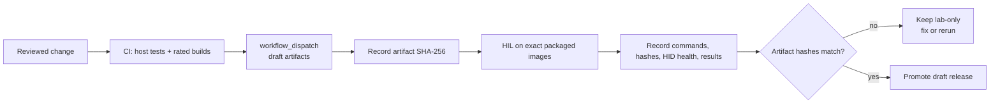

# Releasing PicoUart

Release tags run [`.github/workflows/release.yml`](../.github/workflows/release.yml), which builds and packages firmware,
runs host validation, and opens a **draft** GitHub Release. The workflow and
[firmware build guide](../firmware/build-and-config.md) define the current board matrix, clocks, and artifact names.
The promote HIL gate covers the rated images.

Do not publish the draft until exact-artifact hardware-in-the-loop (HIL) evidence passes the gates below.

A `workflow_dispatch` run creates artifacts for preflight HIL; a release tag creates the draft to promote.

Host application publication follows the [host distribution plan](development/host-distribution.md).
[WebHID Pages](#webhid-pages) deploys separately after release publication; PyPI and .NET distribution remain planned.



The release unit is the exact packaged artifact, not a source revision or a local rebuild. HIL evidence is valid only
when its image hash matches the artifact attached to the draft release.

## Release Preflight

Before requesting HIL, confirm:

1. The change is reviewed and the working tree contains no unintended files.
2. The version follows the [release tag policy](#versioning).
3. Host validation and all required target builds pass in the release workflow.
4. `git diff --check` passes.
5. Release notes identify USB/HID compatibility or behavior changes.

Do not begin physical testing from an uncommitted or locally modified image.

## Security Reporting Setup

Before publishing, enable private vulnerability reporting in repository settings and handle reports privately. User
instructions and device-security notes are in [`SECURITY.md`](../SECURITY.md).

## USB identity

PicoUart artifacts use `cafe:4010`, an unallocated lab identity. Do not reuse it commercially; derivatives need an
allocated VID/PID and must treat the identity change as a breaking USB change. See [`SECURITY.md`](../SECURITY.md) and
the USB identity contract tests before publishing.

## Release HIL Gates

Use the [Test Documentation Index](tests/README.md) for automated validation, HIL sequence, and result semantics. CI
validates builds and host tests; it cannot establish physical qualification.

Release promotion requires a complete `PASS` on every rated board artifact in the release workflow. Run HIL on the exact
packaged UF2/ELF and verify its SHA-256 against the draft; a local rebuild or a result for another artifact does not
qualify the release. Optional overclock profiles are board-local configuration settings; any overclock claim still
requires exact-board HIL evidence and does not establish general stability or operating margins.

Follow the [HIL fixture setup](tests/hil-fixture-setup.md) and [test plan](tests/hil-fixture-test-plan.md) for required
phases and acceptance criteria. Preserve per-board records using the [HIL record format](tests/records/README.md), with
artifact hashes and any failures or partial conditions. Without matching recorded evidence, the release remains lab-only.

## Flashing Release Artifacts

Flash with the packaged ELF/UF2 and skip rebuilding:

```sh
tools/firmware/load.sh --board <pico|pico2> --skip-build --elf <path-to-release.elf>
```

Use `--probe-serial <serial>` when more than one CMSIS-DAP probe is attached or when USB enumeration tools are
unavailable.

On Linux, `unable to find a matching CMSIS-DAP device` can mean USB access is denied even when `lsusb` lists the probe.
The loader checks the USB node permissions for a uniquely enumerated probe and retries OpenOCD with noninteractive
sudo when available, rather than resetting an inaccessible device. If sudo is not authorized, configure a
Debug Probe-specific udev rule for your user/group or authorize sudo before retrying. To distinguish permissions from
probe discovery failures without programming flash, run:

```sh
openocd -d3 -f interface/cmsis-dap.cfg -c 'transport select swd' -c 'adapter speed 1000' -c 'init; shutdown'
```

Use a current OpenOCD CMSIS-DAP build. If OpenOCD reports `Unknown flash device` after detecting the SWD target, update
OpenOCD and retry with `--adapter-speed-khz 1000` before treating the HIL attempt as firmware failure. Flash ID
`0x00154068` is a Boya BY25Q16ES device; older OpenOCD builds may need an upstream binary selected with `--openocd-exe`.

### Override QSPI Auto-Detection (Advanced)

Only use this recovery when SWD communication is stable and the exact QSPI flash capacity has been confirmed from the
chip marking and its datasheet. Do not guess the capacity: OpenOCD uses it to define erase bounds, so a wrong value can
make flash operations unsafe. Prefer a current OpenOCD build and normal JEDEC/SFDP detection whenever possible.

The OpenOCD RP2040/RP2350 target scripts accept a nonzero `FLASHSIZE` in bytes to skip QSPI JEDEC/SFDP auto-detection.
Create a temporary target config that sets the verified capacity before sourcing the board target:

```sh
FLASH_SIZE_BYTES=<confirmed-capacity-in-bytes>
OPENOCD_TARGET_CFG="$(mktemp)"
trap 'rm -f "$OPENOCD_TARGET_CFG"' EXIT
printf 'set FLASHSIZE %s\nsource [find target/rp2040.cfg]\n' "$FLASH_SIZE_BYTES" > "$OPENOCD_TARGET_CFG"
tools/firmware/load.sh --board pico --skip-build --elf <path-to-pico.elf> \
   --openocd-target "$OPENOCD_TARGET_CFG" --probe-serial <probe-serial> --adapter-speed-khz 1000
```

For Pico 2, use `--board pico2`, a Pico 2 ELF, and replace the target in the temporary config with
`target/rp2350.cfg`. Continue only if OpenOCD reports **Verified OK**. This override skips flash identification; it does
not recover failed SWD access, repair reset/wiring, or prove the selected capacity is correct.

## Required HIL Matrix

Follow the [board-testing skill](../.github/skills/pico-uart-board-testing/SKILL.md), [fixture setup](tests/hil-fixture-setup.md),
and [HIL test plan](tests/hil-fixture-test-plan.md) for the current required test matrix. Promotion requires no
unexplained data loss, timeout, USB disconnect, or relevant HID error.

## Optional Claims

Run optional tests only when the release notes claim the behavior:

- Backpressure and hardware/PIO RTS/CTS require the matching board configuration and HIL variants described in the
   [fixture test plan](tests/hil-fixture-test-plan.md).

## Promote checklist (draft → published)

Before publishing, verify the draft hashes match complete HIL records for all rated targets, link those records, and
include any USB identity or HID compatibility notes in the release notes. Release CI must pass its reviewed dependency
lock and build gates.

## Versioning

Tags use plain `vMAJOR.MINOR.PATCH` with no pre-release suffix. The release version resolver owns tag bounds; firmware
build limits may differ. Firmware reports the semantic version over HID and major/minor in `bcdDevice`; see the
[HID Report Reference](design/usb/hid-report-reference.md) for encoding details. Release workflows own the SDK and
toolchain pins and install the reviewed, hash-locked Python requirements.

## WebHID Pages

The [WebHID Pages workflow](../.github/workflows/webhid-pages.yml) publishes the standalone browser app from
`host/webhid`, without modifying or deploying the Python/.NET frontend. It runs when a non-prerelease GitHub Release
is published, after the firmware draft has passed its promotion gates. Pushing a tag, creating a draft, and release
preflight runs do not change the live site.

### Repository Setup

1. Merge the Pages workflow into the repository's default branch so GitHub can receive release events.
2. In **Settings > Pages > Build and deployment**, set **Source** to **GitHub Actions**. No deployment branch, custom
   domain, or personal access token is required.
3. Review the **github-pages** environment under **Settings > Environments**. Permit the release tags used for
   deployment and configure required reviewers if desired. Manual redeployment must also be allowed from the branch
   containing the workflow. Only the deployment job receives `pages: write` and `id-token: write` permissions.

After the first successful deployment, the default project URL is
<https://djwinter29-oss.github.io/PicoUart/>. The deployment job's environment URL is authoritative if Pages settings
or the repository name change. This setup does not claim the site is already live.

### Publish Or Roll Back

Publish the qualified firmware draft through GitHub's release UI to trigger deployment. The Pages workflow validates
the release tag and published/non-prerelease status, checks out that tag, runs the WebHID tests, and uploads only
`host/webhid`. Deployment runs are serialized and retain the selected tag in their workflow inputs/event record.
Publishing through another workflow's default `GITHUB_TOKEN` does not trigger a new release-event workflow; use the
manual deployment below in that case.

For redeployment or rollback, run **Actions > WebHID Pages > Run workflow** with the desired already-published release
tag and leave **test_publish** unchecked. Drafts, prereleases, and tags outside the normal release version policy are
rejected. The selected tag must contain the standalone WebHID app and its tests. Rolling back the site does not modify
firmware releases or boards.

### Test Publish From A Branch

To publish current WebHID without creating a firmware release:

1. Commit and push the WebHID and workflow changes. The workflow must exist on the default branch for manual dispatch
   to be available; the branch selected for the run must include the test-publish option.
2. Open **Actions > WebHID Pages > Run workflow** and select the desired branch under **Use workflow from**.
3. Check **test_publish**, leave **tag** empty, and run the workflow. Ensure the `github-pages` environment permits
   deployment from that branch and approve the deployment if required.
4. Open the deployment's environment URL after the run succeeds.

Test publication deploys the selected branch's exact commit, runs the WebHID checks, and skips only the published-release
lookup. It replaces the site at the normal Pages URL; it is not an isolated preview. Local uncommitted changes are not
included. Restore a release by rerunning with **test_publish** unchecked and the desired published **tag**.

A Pages failure does not unpublish the GitHub Release. Fix or rerun the deployment separately, and inspect the Pages
environment for the currently successful deployment. After deployment, check asset loading at the project URL and
native device access in a supported browser; automated tests do not prove physical USB compatibility.
