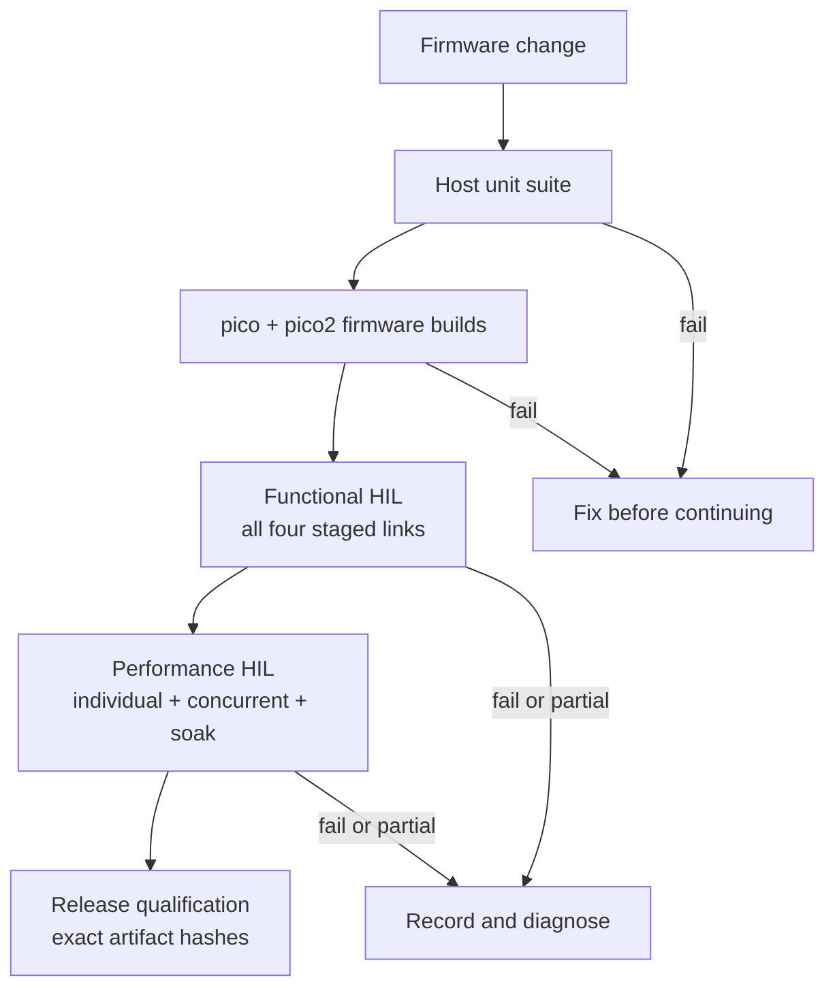

# Testing PicoUart

PicoUart is tested at three levels. Start with the smallest level that covers your change, and never count a partial
hardware run as a full pass.



| Level           | Environment                     | Primary purpose                                                         | Result authority           |
| --------------- | ------------------------------- | ----------------------------------------------------------------------- | -------------------------- |
| Host tests      | Native host                     | Firmware policies plus host applications and cross-project contracts | Relevant CTest, pytest, .NET, or Node result |
| Firmware build  | Pico SDK/toolchain              | Compile/link both RP2040 and RP2350 targets                             | Build artifacts            |
| Functional HIL  | Board + fixed four-link fixture | Enumeration, bidirectional bytes, backend mapping, HID health           | Functional result entry    |
| Performance HIL | Same fixture                    | Throughput, integrity, concurrency, soak, overflow behavior             | Performance result entry   |
| Release HIL     | Exact packaged artifacts        | Qualification of artifacts intended for publication                     | Release checklist + hashes |

## Without Hardware

After the [Python environment setup](../development/host-tools.md#python-environment-setup), run this from the
repository root:

```sh
PYTHON_EXE=host/python/.venv/bin/python tools/validation/run-host-tests.sh
tools/firmware/build.sh --board pico
tools/firmware/build.sh --board pico2
python3 tools/release/check-firmware-budget.py --build-dir build/firmware-pico --board pico
python3 tools/release/check-firmware-budget.py --build-dir build/firmware-pico2 --board pico2
git diff --check
```

The host-test wrapper runs both the native C suite and the Python tests. It does not cover the .NET or browser
dashboards; if you changed those, run their checks from the [tools reference](../../tools/README.md), and report any
check you skipped. None of this proves anything about DMA timing, USB enumeration, multicore load, or physical UART
signalling.

## With Hardware

1. Wire the fixture: [HIL Fixture Setup](hil-fixture-setup.md).
2. Run the functional pass, then the performance pass: [HIL Fixture Test Plan](hil-fixture-test-plan.md). The combined
   `tools/hil/runner/full.sh` runs both and writes a dated record to [records/](records/README.md).
3. For a release, test the exact packaged artifacts and follow the gates in
   [Releasing](../deployment/releasing.md#release-hil-gates).

## Results and Evidence

| Result | Meaning |
| --- | --- |
| `PASS` | Every required case for the declared level passed. |
| `FAIL` | A required case failed, or there was unexplained loss or errors. |
| `PARTIAL` | A case, link, board, or artifact was intentionally left out. It is useful evidence, but it cannot qualify the design or a release. |
| `NOT RUN` | A configured rate was never attempted, for example after a sweep stopped. |
| `NOT REPORTED` | An expected per-stream result is missing. |

Every hardware record should identify:

- the board target and the physical board
- the firmware version, commit, artifact name, and SHA-256
- the test command, duration, and rates
- the wiring variant and the RTS/CTS setting
- per-link results and verified byte integrity
- HID health and overflow deltas
- any USB resets, disconnects, framing errors, or control errors
- relevant measurements and caveats
