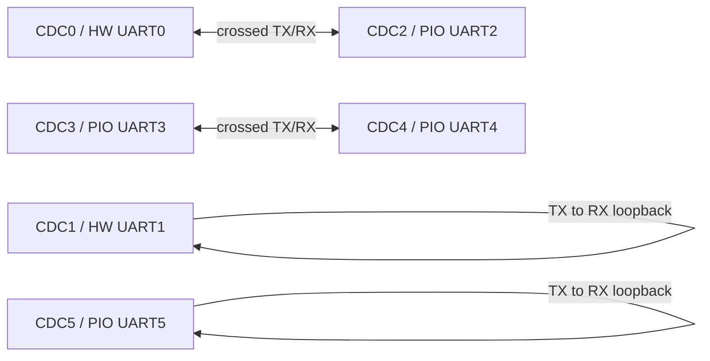

# HIL Fixture Setup

This fixture exercises all six channels with two crossed UART pairs and two loopbacks.

The GPIOs below come from the [port map](../hardware-setup.md#port-map). The functional baseline uses 115200 8N1;
performance runs use the rates and durations in the [HIL test plan](hil-fixture-test-plan.md).

## Equipment

- PicoUart board with a flashed Pico or Pico 2
- USB data cable from the PicoUart board to the host
- Jumper wires
- Host computer with the PicoUart host tools installed

The runners use a separate HIL environment. Create it once with `tools/hil/setup.sh`, which needs uv and network
access. It does not touch the board.

## Electrical Safety

- Disconnect power before installing jumpers or checking continuity; reconnect only after verifying the wiring.
- Leave RTS/CTS disconnected for the baseline fixture.

## Fixed Fixture Wiring

Wire these four links before starting a runner; runner stage numbers match the table. Do not move jumpers between
stages.

| Stage | Connection | GPIO wiring |
| --- | --- | --- |
| 1 | Cross CDC0 TX to CDC2 RX | GP0 → GP9 |
| 1 | Cross CDC2 TX to CDC0 RX | GP8 → GP1 |
| 2 | Cross CDC3 TX to CDC4 RX | GP12 → GP17 |
| 2 | Cross CDC4 TX to CDC3 RX | GP16 → GP13 |
| 3 | Loop CDC1 TX to CDC1 RX | GP4 → GP5 |
| 4 | Loop CDC5 TX to CDC5 RX | GP20 → GP21 |

Before testing, identify the board's six CDC ports using the
[serial-port guide](../hardware-setup.md#find-the-serial-ports). The runner checks HID enumeration. Remove all test
jumpers before connecting external UART equipment. To exercise a port against a real peer instead, see the
[external-peer check](../hardware-setup.md#check-a-peer-connection).
