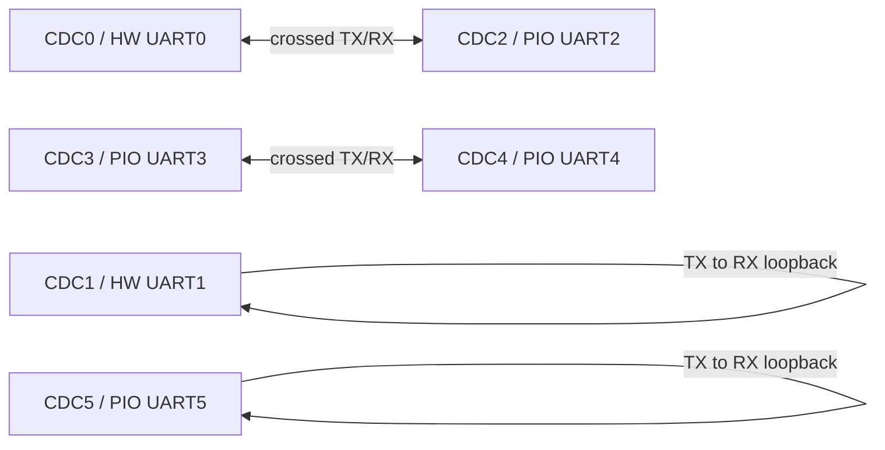

# HIL Fixture Setup

This fixture exercises all six channels with two crossed UART pairs and two loopbacks.



The GPIOs below come from the [port map](../hardware-setup.md#port-map). Run the fixture at the firmware default of
115200 8N1.

## Equipment

- PicoUart board with a flashed Pico or Pico 2
- USB data cable from the PicoUart board to the host
- Jumper wires
- Host computer with the PicoUart host tools installed

The runners use a separate HIL environment. Create it once with `tools/hil/setup.sh`, which needs uv and network
access. It does not touch the board.

## Electrical Safety

- Disconnect power before installing jumpers or checking continuity; reconnect only after verifying the wiring.
- Use 3.3 V UART logic and connect a shared ground between the board and every link.
- Never connect UART TX to TX or RX to RX.
- Never connect RS-232 voltage levels directly to Pico GPIOs.
- Leave RTS/CTS disconnected for the baseline fixture.
- Power the board through its intended USB connection; do not add an external UART voltage source to signal pins.

## Fixed Fixture Wiring

Wire these four links before starting a runner. Do not move jumpers between stages.

### Link 1: Hardware UART0 to PIO UART2

Cross the signal directions between UART0/CDC0 and UART2/CDC2:

| UART0 signal | GPIO | UART2 signal | GPIO |
| ------------ | ---- | ------------ | ---- |
| TX           | GP0  | RX           | GP9  |
| RX           | GP1  | TX           | GP8  |

### Link 2: PIO UART3 to PIO UART4

Cross the signal directions between UART3/CDC3 and UART4/CDC4:

| UART3 signal | GPIO | UART4 signal | GPIO |
| ------------ | ---- | ------------ | ---- |
| TX           | GP12 | RX           | GP17 |
| RX           | GP13 | TX           | GP16 |

### Link 3: Hardware UART1 Loopback

Connect UART1/CDC1 TX to its own RX:

| PicoUart signal | GPIO | PicoUart signal | GPIO |
| --------------- | ---- | --------------- | ---- |
| TX              | GP4  | RX              | GP5  |

### Link 4: PIO UART5 Loopback

Connect UART5/CDC5 TX to its own RX:

| PicoUart signal | GPIO | PicoUart signal | GPIO |
| --------------- | ---- | --------------- | ---- |
| TX              | GP20 | RX              | GP21 |

## Bring-Up Checklist

1. Verify the four links above.
2. Flash the intended artifact using [USB](../hardware-setup.md#installing-firmware) or
   [SWD](../../firmware/build-and-config.md#debug-probe-loading-and-recovery), then record its version and SHA-256.
3. Connect the PicoUart USB device and confirm that CDC0 through CDC5 plus HID enumerate.
4. Run the functional and performance plans.
5. Remove all test jumpers before connecting external UART equipment.

## Endpoint Preflight

Before running a test runner, record the stable device paths:

```sh
ls -l /dev/serial/by-id/
```

Expected endpoints are six PicoUart CDC serial ports. The HID interface may not appear as a serial path; verify it with
the HID host tool or the runner's enumeration step. Do not guess interface numbers from `/dev/ttyACM*` ordering when
stable by-id paths are available.

Stop the test and inspect the wiring if a channel fails in both directions, a CDC interface disappears, the board resets
unexpectedly, or a signal appears to be at the wrong voltage.

## Optional Manual External-Peer Check

A Debug Probe UART connection may be tested manually as an external peer, but it is not part of this HIL fixture or its
pass criteria. Disconnect power and remove the baseline fixture jumpers before connecting an external peer, so two TX
outputs cannot drive the same RX line. Wire one PicoUart port to the probe using crossed TX/RX and shared ground, then
reconnect power and run:

```sh
tools/hil/runner/bridge.sh \
  --pico-port /dev/serial/by-id/<pico-cdc-endpoint> \
  --peer-port /dev/serial/by-id/<debug-probe-uart> \
  --label manual-debug-probe --baud 115200
```

Disconnect power before restoring all four fixture links for a subsequent baseline HIL run.
