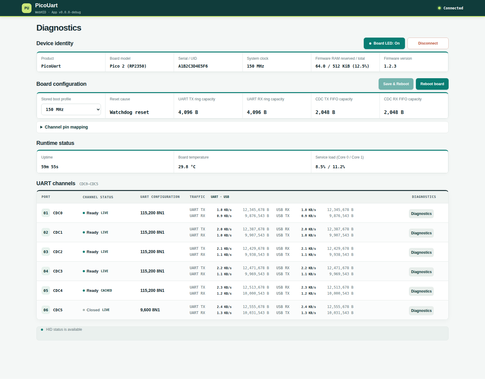

# PicoUart

**See what your UART bridge is doing, without taking over your serial ports.**

The `pico-uart` package adds a Python API, command-line tools, and a local web dashboard to the
[PicoUart](https://github.com/djwinter29-oss/PicoUart) six-channel USB-to-UART bridge.
For **Windows, Linux, and macOS** with **Python 3.10+**.

[PyPI](https://pypi.org/project/pico-uart/) ·
[Source](https://github.com/djwinter29-oss/PicoUart) ·
[Firmware releases](https://github.com/djwinter29-oss/PicoUart/releases) ·
[Report an issue](https://github.com/djwinter29-oss/PicoUart/issues)

Inspect channel health, traffic, and dropped-byte counts, or save diagnostics alongside your test results.

Diagnostics use **USB HID**, separate from the six USB CDC serial ports. Keep using your terminal or serial library
for UART payloads, baud rates, and framing. The browser talks to Python, so it does not need WebHID support.



*Illustrative Direct Dashboard with simulated telemetry, not a live hardware result. The Python dashboard uses
the shared frontend; its layout and controls may differ.*

## Quick Start

Create and activate a virtual environment on Linux or macOS:

```sh
python3 -m venv .venv
. .venv/bin/activate
```

On Windows PowerShell:

```powershell
py -m venv .venv
.\.venv\Scripts\Activate.ps1
```

Then install the package:

```sh
python -m pip install pico-uart
```

This installs the latest stable release with the API, CLI, and dashboard. To opt in to prerelease builds for testing,
add `--pre`.

**Using PyPI 0.11.0?** That release includes Flask with this same install, but starts the dashboard with
`pico-uart web`; use `pico-uart dashboard` with a release that provides that command.
For an isolated installation, use `pipx install pico-uart` instead.

Connect a Pico or Pico 2 running [PicoUart firmware](https://github.com/djwinter29-oss/PicoUart/releases), then run:

```sh
pico-uart dashboard
```

Open **<http://127.0.0.1:5000/>** on the computer running Python. Use **Board** to select a device and **Rescan** to refresh.
Stop the server with `Ctrl+C`. If the port is occupied, run `pico-uart dashboard --port 5001`.

**Before wiring UART devices:** signals are 3.3 V only; never connect 5 V or RS-232 signals directly. Follow the
[hardware setup guide](https://github.com/djwinter29-oss/PicoUart/blob/main/docs/hardware-setup.md).

## Command-Line Tools

| Task | Command |
| --- | --- |
| Read a channel status update | `pico-uart status` |
| Save status as JSON | `pico-uart status --json` |
| Watch traffic for 60 seconds | `pico-uart monitor --duration 60` |
| Read cumulative RX dropped-byte counts | `pico-uart overruns` |
| Inspect hardware or boot configuration | `pico-uart hardware` / `pico-uart config` |

Run `pico-uart --help` for all commands. To select a board, put `--serial SERIAL` or `--device-path PATH`
**before** the command:

```sh
pico-uart --serial ABC123 status
```

Use one HID monitor/server per physical board; separate processes do not share input reports or traffic totals.

For automated tests, redirect `status --json` or `monitor` output to a file alongside your serial test results.
A successful command does **not** prove continuous reporting or healthy channels; see
[result interpretation](https://github.com/djwinter29-oss/PicoUart/blob/main/docs/development/host-tools.md#python-test-automation).

## Python API

Read a status snapshot without changing board settings:

```python
from pico_uart import PicoUartHid

with PicoUartHid() as board:
    status = board.read_status(timeout_ms=1000)
if status is None:
    raise RuntimeError("no PicoUart status report received")
print(status["channels"])
```

The context manager closes the connection. A snapshot may contain channels still waiting for data; it does not wait
for fresh reports from all six. Python `status --json` and .NET `status` both print that six-entry `channels`
object. The field rules are in the
[host tools guide](https://github.com/djwinter29-oss/PicoUart/blob/main/docs/development/host-tools.md#python-test-automation).
Use `PicoUartHid(serial_number="ABC123")` to select a board.
See the [Python client guide](https://github.com/djwinter29-oss/PicoUart/blob/main/docs/development/host-tools.md#python-client-api)
for methods, UART readiness checks, errors, board controls, and waiting for deferred HID cleanup after a timed-out
transfer.

## Troubleshooting

- **Board not found:** check firmware, the USB data cable, and the selected serial number or device path. The board
  must be connected to the computer running Python. With no board attached, a HID command failing is expected.
- **Access denied:** follow the
  [Linux HID permissions guide](https://github.com/djwinter29-oss/PicoUart/blob/main/tools/README.md#linux-hid-permissions).
  Do not run the dashboard as root to bypass permissions.
- **Port already in use:** start the dashboard with `pico-uart dashboard --port 5001`.
- **Installation fails building hidapi:** if pip cannot find a compatible wheel and tries to build hidapi from source,
  follow the [host setup guide](https://github.com/djwinter29-oss/PicoUart/blob/main/docs/development/host-tools.md#python-environment-setup)
  for native prerequisites, or use a Python/platform combination with a compatible wheel.
- **PowerShell activation blocked:** run these commands directly:

  ```powershell
  .\.venv\Scripts\python.exe -m pip install pico-uart
  .\.venv\Scripts\pico-uart.exe dashboard
  ```
- **No valid reports:** check firmware compatibility and the USB connection. A timeout does not mean zero traffic.
- **Unconfirmed board action:** reconnect and inspect state. Never automatically retry a save or reboot.

Saving configuration reboots the board. Close all CDC ports and stop UART traffic first; review the
[save safety contract](https://github.com/djwinter29-oss/PicoUart/blob/main/docs/design/usb/hid-report-reference.md#save-and-reboot-safety)
before changing settings.

## Documentation

- [Published release notes](https://github.com/djwinter29-oss/PicoUart/releases)
- [Upcoming changes (unreleased)](https://github.com/djwinter29-oss/PicoUart/blob/main/host/python/CHANGELOG.md)
- [Installation from a checkout, tests, and host development](https://github.com/djwinter29-oss/PicoUart/blob/main/docs/development/host-tools.md)
- [Project, firmware, and wiring](https://github.com/djwinter29-oss/PicoUart)
- [HID report reference and compatibility](https://github.com/djwinter29-oss/PicoUart/blob/main/docs/design/usb/hid-report-reference.md)
- [Security policy and trust model](https://github.com/djwinter29-oss/PicoUart/blob/main/SECURITY.md)

## License

Released under the [BSD 3-Clause License](https://github.com/djwinter29-oss/PicoUart/blob/main/LICENSE).
For bug reports, include the package and firmware versions, operating system, and exact error message.
