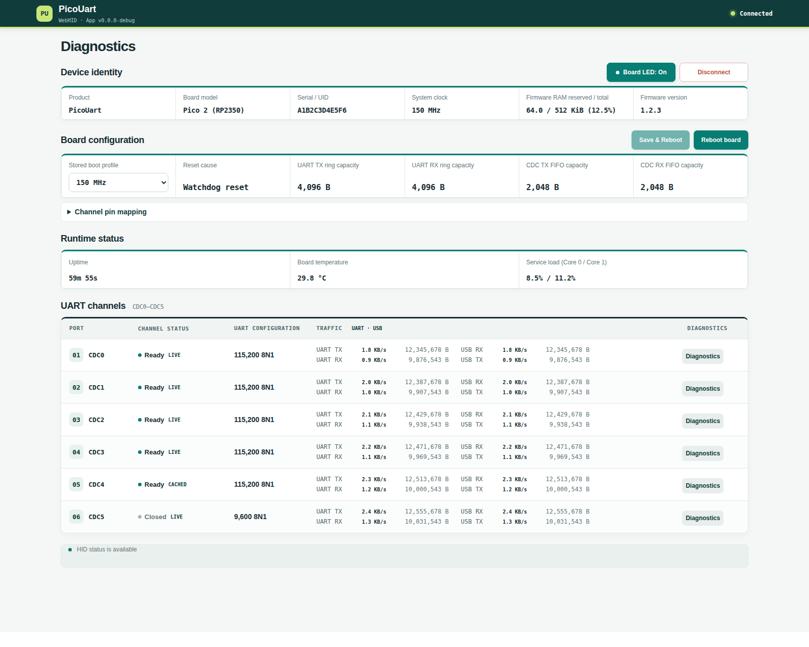

# PicoUart

Python API, command-line tools, and a local dashboard for the
[PicoUart](https://github.com/djwinter29-oss/PicoUart) six-channel USB-to-UART bridge. Works on Windows, Linux, and
macOS with Python 3.10+.

[PyPI](https://pypi.org/project/pico-uart/) ·
[Source](https://github.com/djwinter29-oss/PicoUart) ·
[Firmware releases](https://github.com/djwinter29-oss/PicoUart/releases) ·
[Report an issue](https://github.com/djwinter29-oss/PicoUart/issues)

The tools read channel health, traffic counters, and dropped-byte counts over the board's USB HID interface. That is
separate from the six CDC serial ports, so keep using your terminal or serial library for UART data, baud rate, and
framing. The dashboard runs in your browser but talks to Python, so it needs no WebHID support.



*Illustrative screenshot of the Direct Dashboard with simulated telemetry. The Python dashboard shares its frontend,
but layout and controls may differ.*

## Install

Use a virtual environment:

```sh
python3 -m venv .venv
. .venv/bin/activate          # Windows PowerShell: .\.venv\Scripts\Activate.ps1
python -m pip install pico-uart
```

If PowerShell blocks activation, skip it and call `.\.venv\Scripts\python.exe` and `.\.venv\Scripts\pico-uart.exe`
directly. `pipx install pico-uart` also works, and `--pre` installs prereleases.

PyPI 0.11.0 starts the dashboard with `pico-uart web`; later releases use `pico-uart dashboard`.

## Dashboard

Connect a Pico or Pico 2 running [PicoUart firmware](https://github.com/djwinter29-oss/PicoUart/releases), then run:

```sh
pico-uart dashboard
```

Open <http://127.0.0.1:5000/> on the same computer. Pick a board from the **Board** list and click **Rescan** after
plugging one in. Press `Ctrl+C` to stop; add `--port 5001` if the port is taken.

Wiring: UART signals are 3.3 V only. Never connect 5 V or RS-232 directly. See the
[hardware setup guide](https://github.com/djwinter29-oss/PicoUart/blob/main/docs/hardware-setup.md).

## Command Line

| Task | Command |
| --- | --- |
| Read one channel status update | `pico-uart status` |
| Save status as JSON | `pico-uart status --json` |
| Watch traffic for 60 seconds | `pico-uart monitor --duration 60` |
| Show cumulative RX dropped-byte counts | `pico-uart overruns` |
| Show hardware or boot configuration | `pico-uart hardware` / `pico-uart config` |

`pico-uart --help` lists everything. With several boards attached, put `--serial SERIAL` or `--device-path PATH`
before the command, for example `pico-uart --serial ABC123 status`.

To keep diagnostics with a test run, redirect `status --json` or `monitor` output next to your serial logs. A command
that exits successfully only means it got a report, so have your test check the reported channel states and counters.
Run one monitor or dashboard per board; separate processes do not share reports.

## Python API

```python
from pico_uart import PicoUartHid

with PicoUartHid() as board:
    status = board.read_status(timeout_ms=1000)
if status is None:
    raise RuntimeError("no PicoUart status report received")
print(status["channels"])
```

The snapshot has six channels, some of which may still be waiting for their first report. Pass
`serial_number="ABC123"` to pick a board. Other methods, readiness checks, and board controls are in the
[Python client guide](https://github.com/djwinter29-oss/PicoUart/blob/main/docs/development/host-tools.md#python-client-api).

## Troubleshooting

- **Board not found:** check the firmware, the USB data cable, and the serial number or path you selected. The board
  must be plugged into the computer running Python. Without a board, HID commands fail by design.
- **Access denied:** set up [Linux HID permissions](https://github.com/djwinter29-oss/PicoUart/blob/main/tools/README.md#linux-hid-permissions)
  rather than running as root.
- **Installation fails building hidapi:** pip found no wheel for your platform. Follow the
  [host setup guide](https://github.com/djwinter29-oss/PicoUart/blob/main/docs/development/host-tools.md#python-environment-setup)
  for the native prerequisites.
- **No reports:** check firmware compatibility and the USB connection. A timeout is not the same as zero traffic.

Saving a boot configuration reboots the board. Close all serial ports and stop UART traffic first, and if the result is
unclear, reconnect and check the board before saving again. Details are in the
[save and reboot rules](https://github.com/djwinter29-oss/PicoUart/blob/main/docs/design/usb/hid-report-reference.md#save-and-reboot-safety).

## More

- [Release notes](https://github.com/djwinter29-oss/PicoUart/releases) and
  [unreleased changes](https://github.com/djwinter29-oss/PicoUart/blob/main/host/python/CHANGELOG.md)
- [Developing from a checkout](https://github.com/djwinter29-oss/PicoUart/blob/main/docs/development/host-tools.md)
- [HID report reference](https://github.com/djwinter29-oss/PicoUart/blob/main/docs/design/usb/hid-report-reference.md)
- [Security policy](https://github.com/djwinter29-oss/PicoUart/blob/main/SECURITY.md)

Released under the [BSD 3-Clause License](https://github.com/djwinter29-oss/PicoUart/blob/main/LICENSE). For bug
reports, include the package and firmware versions, your OS, and the exact error message.
